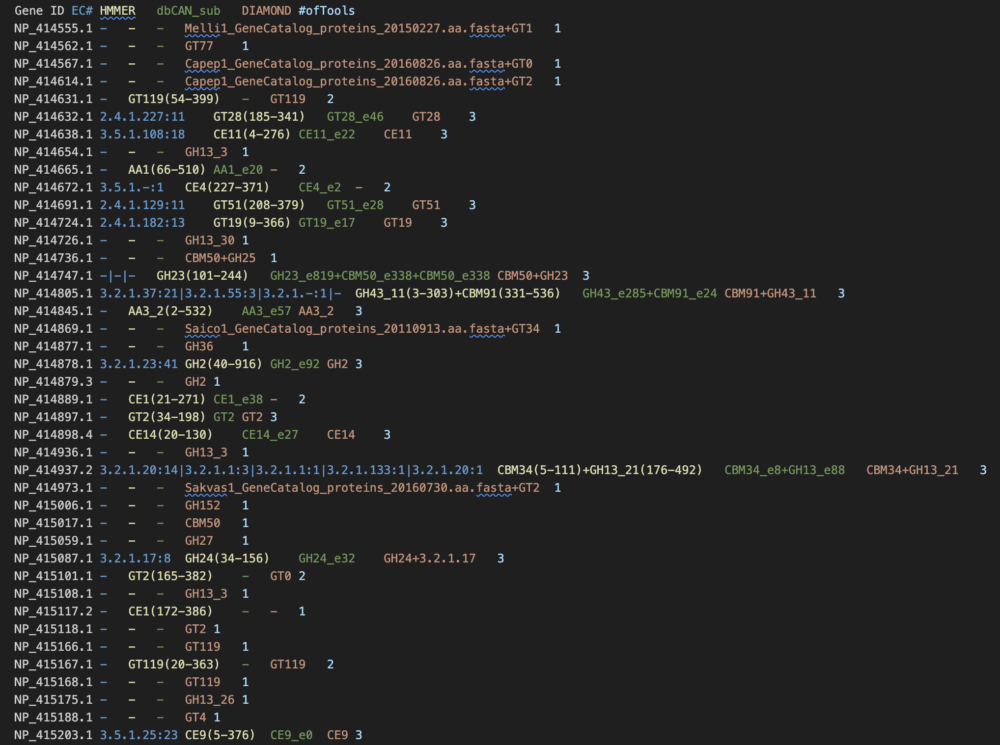
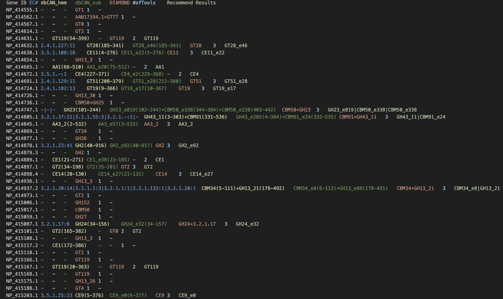

CAZyme annotation comparison
============================

run_dbCAN v5 finds the same core CAZymes as v4 on the same input (*E. coli* K-12 MG1655 proteome), several times
faster and with a richer ``overview.tsv``.

   ``overview`` of run_dbCAN v4.

   ``overview.tsv`` of run_dbCAN v5.

Output changes
--------------

.. list-table::
   :widths: 24 76
   :header-rows: 1

   * - Change
     - Example
   * - Domain coordinates for dbCAN HMM **and** dbCAN-sub
     - v5: ``GH23(101-244)  GH23_e819(102-244)+CBM50_e338(344-384)+CBM50_e338(403-442)``
       v4: ``GH23(101-244)  GH23_e819+CBM50_e338+CBM50_e338``
   * - New ``Recommend Results`` column (``#ofTools`` >= 2)
     - ``NP_414632.1  2.4.1.227:11  GT28(185-341)  GT28_e46(185-341)  GT28  3  GT28_e46``
   * - Clean ``DIAMOND`` column (families only)
     - v5: ``GT1``; v4: ``Melli1_GeneCatalog_proteins_20150227.aa.fasta+GT1``

Current versions also add a ``Substrate`` column. All columns and the ``Recommend Results`` rule are described in
:ref:`overview-columns`.

Run time
--------

40 CPUs; pyHMMER and pyrodigal replace HMMER and Prodigal.

.. list-table::
   :header-rows: 1
   :widths: 40 30 30

   * - Dataset
     - v4
     - v5
   * - *E. coli* K-12 genome (~4.6 Mb)
     - 32 min 24 s
     - 5 min 58 s
   * - *Xylona heveae* TC161
     - 1 h 02 min 02 s
     - 5 min 50 s

Times depend on the CPU and the disks of the server; use them as a rough guide.
