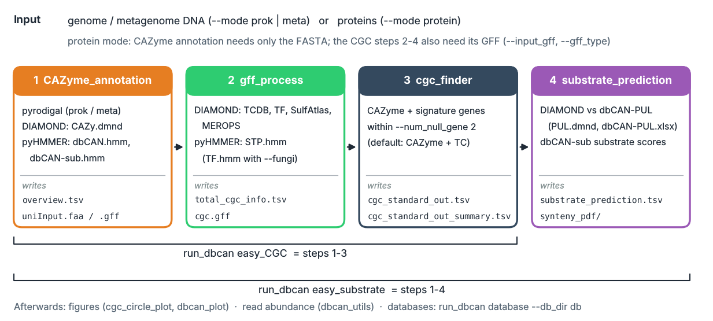

Quick Start
===========

Run the whole pipeline on an example genome with one command, then find your results in the tables below.
Install run_dbCAN first (:doc:`installation`) and activate its environment.

   ``easy_substrate`` runs steps 1-4, ``easy_CGC`` steps 1-3, ``CAZyme_annotation`` step 1 only. Each step can
   also be run on its own (user guide pages).

1. Databases and example data
-----------------------------

.. code-block:: shell

   run_dbcan database --db_dir db          # ~8 GB, once; add --aws_s3 for the pinned release

   T=https://bcb.unl.edu/dbCAN2/download/test
   wget -q $T/NCBI_prok_test/EscheriaColiK12MG1655.fna      # E. coli K-12 genome
   wget -q $T/NCBI_prok_test/EscheriaColiK12MG1655.faa      # ... its proteins
   wget -q $T/NCBI_prok_test/EscheriaColiK12MG1655.gff      # ... and NCBI annotation
   wget -q $T/NCBI_euk_test/Xylona_heveae_TC161.faa         # fungus, NCBI proteins
   wget -q $T/NCBI_euk_test/Xylona_heveae_TC161.gff
   wget -q $T/JGI_test/Xylhe1_GeneCatalog_proteins_20130827.aa.fasta   # same fungus, JGI annotation
   wget -q $T/JGI_test/Xylhe1_GeneCatalog_proteins_20130827.gff

2. Choose the command
---------------------

.. list-table::
   :widths: 34 66
   :header-rows: 1

   * - You want
     - Command
   * - CAZymes only
     - ``run_dbcan CAZyme_annotation`` (protein input needs only the FASTA)
   * - CAZymes + CAZyme gene clusters (CGCs)
     - ``run_dbcan easy_CGC``
   * - CAZymes + CGCs + CGC substrates
     - ``run_dbcan easy_substrate``

``--mode`` describes the input: ``prok`` (bacterial/archaeal genome, DNA), ``meta`` (metagenome assembly, DNA)
or ``protein`` (any proteome). For CGCs from **proteins**, also give the GFF of the same annotation with
``--input_gff`` and ``--gff_type``; DNA input gets its GFF from pyrodigal.

3. Run
------

**Bacterial genome (DNA)**

.. code-block:: shell

   run_dbcan easy_substrate --mode prok --input_raw_data EscheriaColiK12MG1655.fna \
     --output_dir output_EscheriaColiK12MG1655_fna --db_dir db

**Bacterial proteome + NCBI GFF**

.. code-block:: shell

   run_dbcan easy_substrate --mode protein --input_raw_data EscheriaColiK12MG1655.faa \
     --input_gff EscheriaColiK12MG1655.gff --gff_type NCBI_prok \
     --output_dir output_EscheriaColiK12MG1655_faa --db_dir db

**Fungal proteome + NCBI GFF** (``--fungi`` uses the fungal transcription factor HMMs)

.. code-block:: shell

   run_dbcan easy_substrate --mode protein --input_raw_data Xylona_heveae_TC161.faa \
     --input_gff Xylona_heveae_TC161.gff --gff_type NCBI_euk --fungi \
     --output_dir output_Xylona_heveae_TC161_faa --db_dir db

**Fungal proteome + JGI GFF**

.. code-block:: shell

   run_dbcan easy_substrate --mode protein --input_raw_data Xylhe1_GeneCatalog_proteins_20130827.aa.fasta \
     --input_gff Xylhe1_GeneCatalog_proteins_20130827.gff --gff_type JGI --fungi \
     --output_dir output_Xylhe1_faa --db_dir db

**CAZymes only** (any of the inputs above; no GFF needed)

.. code-block:: shell

   run_dbcan CAZyme_annotation --mode protein --input_raw_data Xylona_heveae_TC161.faa \
     --output_dir output_Xylona_CAZyme --db_dir db

``easy_CGC`` takes the same options as ``easy_substrate``. Other annotations (funannotate, BRAKER, GFF3, GTF) are
listed in :ref:`cgc-information-generation`.

.. note::

   There is no eukaryotic **genome** mode: pyrodigal (``prok``/``meta``) predicts prokaryotic genes only. Annotate
   a fungal genome with funannotate, BRAKER or similar (or use the NCBI/JGI annotation) and run its proteins with
   ``--mode protein``.

4. Results
----------

All files are written to ``--output_dir``. The ones you will open first are in **bold**.

.. list-table::
   :widths: 32 12 56
   :header-rows: 1

   * - File
     - Step
     - Content
   * - **overview.tsv**
     - 1
     - One row per protein with a CAZyme hit; trust ``#ofTools`` >= 2 (see :ref:`overview-columns`)
   * - ``uniInput.faa`` / ``uniInput.gff``
     - 1
     - Proteins used by all tools; pyrodigal genes (DNA input only)
   * - ``diamond.out``, ``dbCAN_hmm_results.tsv``, ``dbCANsub_hmm_results.tsv``
     - 1
     - Raw hits of DIAMOND (CAZy), dbCAN HMM and dbCAN-sub HMM
   * - ``total_cgc_info.tsv``
     - 2
     - Transporter (TC), TF, STP, sulfatase and peptidase hits (from ``diamond.out.*``, ``*_hmm_results.tsv``)
   * - ``cgc.gff``
     - 2
     - Your genes with their CAZyme / signature labels: the input of ``cgc_finder``
   * - **cgc_standard_out.tsv**
     - 3
     - One row per gene of every CGC; ``cgc_standard_out_summary.tsv``: one row per CGC
   * - **substrate_prediction.tsv**
     - 4
     - Predicted substrate of each CGC (dbCAN-PUL homology and dbCAN-sub)
   * - ``synteny_pdf/``, ``PUL_blast.out``
     - 4
     - CGC vs best dbCAN-PUL figures; raw DIAMOND hits against dbCAN-PUL

Next: draw the CGCs (:doc:`../user_guide/CGC_plots`, examples in the :ref:`figure_gallery`), or count reads per
family and CGC (:doc:`../user_guide/abundance`).
