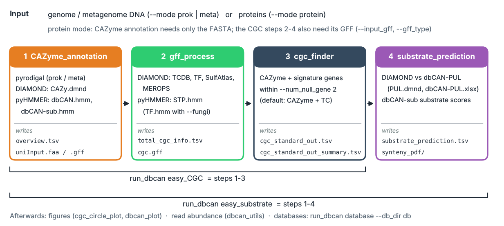

run_dbCAN
=========

**run_dbCAN** annotates carbohydrate-active enzymes (CAZymes) in genomes, metagenomes and proteomes, finds
CAZyme gene clusters (CGCs) and predicts the glycan substrates of these clusters. It is the standalone version of
the `dbCAN3 web server <https://bcb.unl.edu/dbCAN2/>`_.

   The four steps of run_dbcan. Each step is one command; ``easy_CGC`` and ``easy_substrate`` run several of
   them in one go.

Start here
----------

#. :doc:`getting_started/installation` (conda, pip or Docker)
#. :doc:`user_guide/prepare_the_database` (``run_dbcan database --db_dir db``, about 8 GB)
#. :doc:`getting_started/quick_start`: one command per task on example genomes
#. The step pages of the user guide, for options and output columns

Problems or unexpected results? See :doc:`FAQ/troubleshooting`. To start from raw metagenomic reads, use the
**Metagenomics pipeline** or the **Nextflow pipeline** sections.

What is new in version 5
------------------------

.. list-table::
   :widths: 28 72
   :header-rows: 1

   * - Area
     - Change
   * - Databases
     - ``run_dbcan database`` downloads everything; ``--aws_s3`` for a pinned, reproducible release;
       ``--no-cgc`` for the CAZyme databases only.
   * - Speed
     - `pyrodigal <https://pyrodigal.readthedocs.io/en/stable/>`_ replaces Prodigal,
       `pyHMMER <https://pyhmmer.readthedocs.io/en/stable/>`_ replaces HMMER (with a low-memory mode), DIAMOND
       replaces BLAST in substrate prediction.
   * - ``overview.tsv``
     - Domain coordinates for dbCAN-HMM and dbCAN-sub, a ``Recommend Results`` consensus (proteins found by
       >= 2 tools) and a ``Substrate`` column; see :ref:`overview-columns`.
   * - CGCs
     - NCBI, JGI, Prodigal, funannotate, BRAKER, GFF3 and GTF annotations; eukaryotic (e.g. fungal) proteomes with
       their GFF (**beta**); peptidase and sulfatase signature genes.
   * - Figures
     - Genome-wide CGC plots, CGC maps with read depth, synteny with dbCAN-PUL: see the :ref:`figure_gallery`.
   * - Optional tools
     - SignalP 6.0 and DeepTMHMM columns in ``overview.tsv`` (installed by the user):
       :doc:`user_guide/signalp6_deeptmhmm`.
   * - Logging
     - ``--log-level``, ``--log-file`` and ``-v`` on every command.

Contact
-------

* Dr. Yanbin Yin, Professor (yyin@unl.edu)
* Xinpeng Zhang, PhD Student (xzhang55@huskers.unl.edu)
* Dr. Haidong Yi, Software Engineer (hyi@stjude.org)

Conda environment files: `run_dbcan/envs <https://github.com/bcb-unl/run_dbcan/tree/master/envs>`_.
Please report problems on `GitHub issues <https://github.com/bcb-unl/run_dbcan/issues>`_.

.. toctree::
   :maxdepth: 1
   :caption: Getting started

   getting_started/installation
   getting_started/database_description
   getting_started/quick_start

.. toctree::
   :maxdepth: 1
   :caption: User guide

   user_guide/prepare_the_database
   user_guide/CAZyme_annotation
   user_guide/signalp6_deeptmhmm
   user_guide/CGC_information_generation
   user_guide/CGC_annotation
   user_guide/predict_CGC_substrate
   user_guide/CGC_plots
   user_guide/figure_gallery
   user_guide/abundance

.. toctree::
   :maxdepth: 1
   :caption: FAQ

   FAQ/troubleshooting

.. toctree::
   :maxdepth: 1
   :caption: Comparison

   comparison/CAZyme_annotation_compare

.. toctree::
   :maxdepth: 1
   :caption: API

   api/index

.. toctree::
   :maxdepth: 1
   :caption: Metagenomics pipeline

   metagenomics_pipeline/run_from_raw_reads
   metagenomics_pipeline/run_from_raw_reads_am
   metagenomics_pipeline/run_from_raw_reads_pr
   metagenomics_pipeline/run_from_raw_reads_wk
   metagenomics_pipeline/run_from_raw_reads_em
   metagenomics_pipeline/supplement/run_from_raw_reads_sp_co_assem
   metagenomics_pipeline/supplement/run_from_raw_reads_sp_subsample
   metagenomics_pipeline/supplement/run_from_raw_reads_sp_assem_free

.. toctree::
   :maxdepth: 1
   :caption: Nextflow Pipeline

   nextflow/index

.. toctree::
   :maxdepth: 1
   :caption: Change logs

   change-logs/index

.. toctree::
   :maxdepth: 1
   :caption: References

   references/index

.. toctree::
   :maxdepth: 1
   :caption: Contributors

   contributors/index
