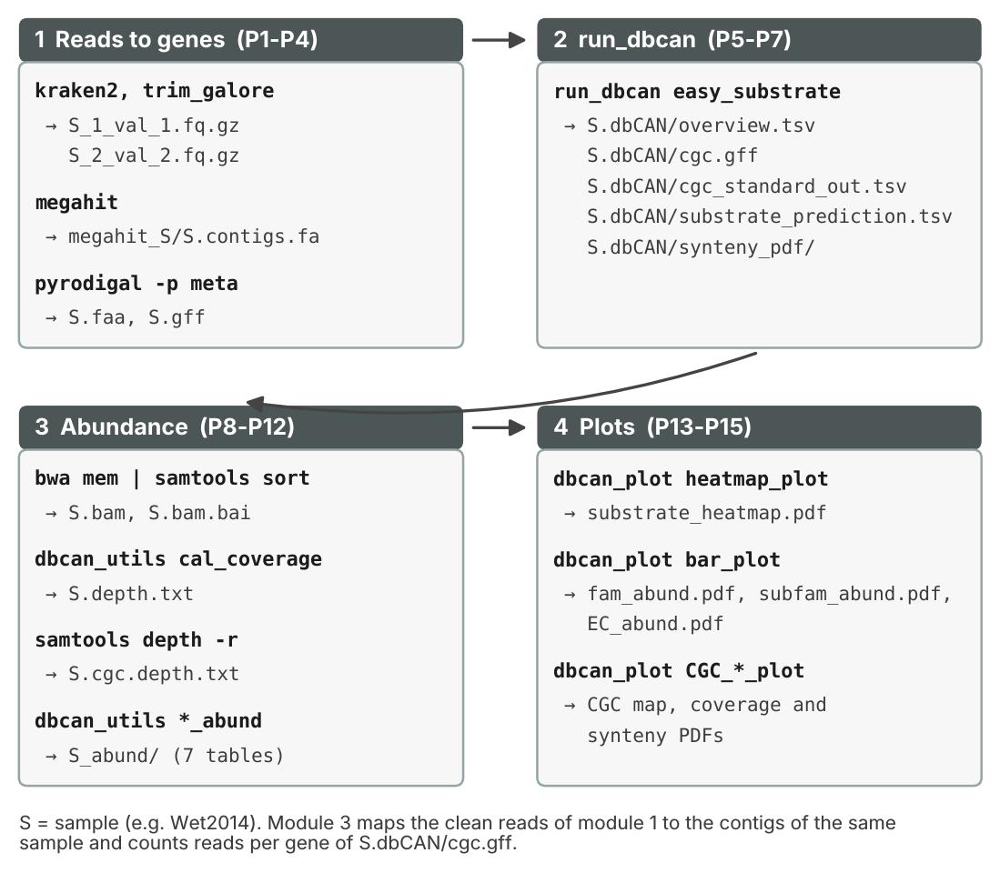
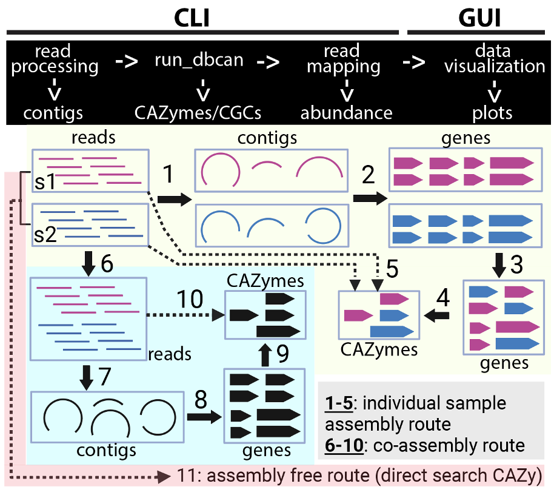
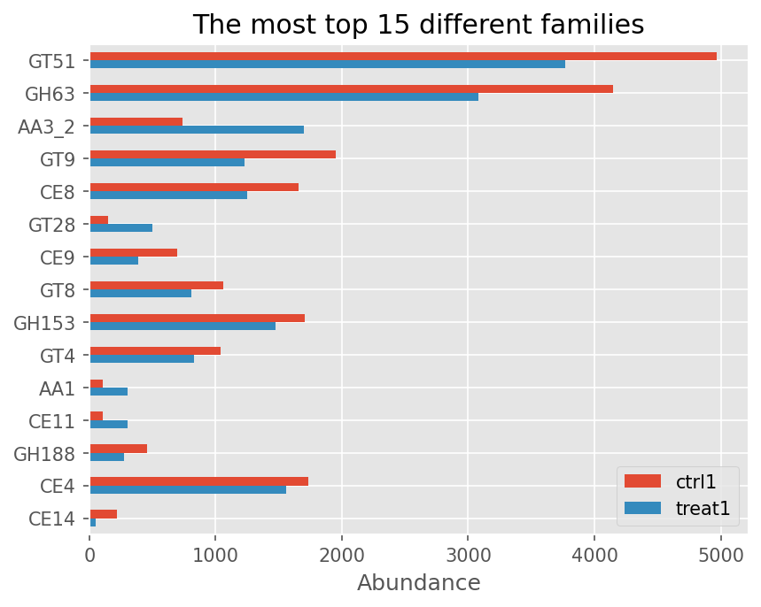
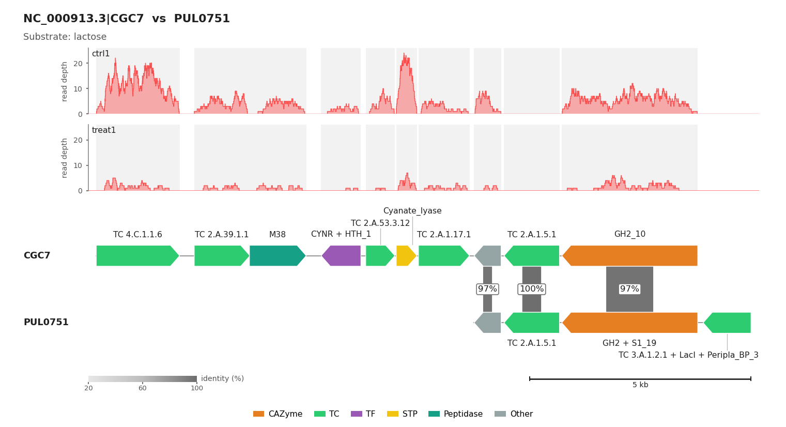

.. _metagenomics-protocol:

Metagenomics protocol: raw reads to CAZyme abundance (Carter 2023)
==================================================================

This protocol takes paired-end metagenomic reads to CAZymes, CGCs, glycan substrates and their abundance,
step by step, on two samples of the Carter 2023 soil dataset (`Carter et al., Cell 2023
<https://www.sciencedirect.com/science/article/pii/S0092867423005974>`_). It is the reference page: the other
datasets and routes below only list what differs and link back to the steps here.

   The four modules, the command of each step and the files it writes (``S`` = sample name; click to enlarge).

.. list-table:: Example datasets and routes
   :header-rows: 1
   :widths: 30 70

   * - Page
     - What differs from this page
   * - Carter 2023 (this page)
     - Soil, 2 samples (Wet2014, Dry2014), individual assembly
   * - :doc:`Wastyk 2021 <run_from_raw_reads_wk>`
     - Human gut, 2 time points of one participant
   * - :doc:`Priest 2023 <run_from_raw_reads_pr>`
     - Arctic seawater: PacBio HiFi metagenomes (Flye) + Illumina metatranscriptomes
   * - :doc:`Amelia 2024 <run_from_raw_reads_am>`
     - Soil after wildfire, 2 samples
   * - :doc:`Emilson 2024 <run_from_raw_reads_em>`
     - Soil at two depths: metagenomes + metatranscriptomes
   * - :doc:`Co-assembly <supplement/run_from_raw_reads_sp_co_assem>`
     - Carter 2023, one co-assembly of both samples
   * - :doc:`Sub-sampling <supplement/run_from_raw_reads_sp_subsample>`
     - Carter 2023, 20 M read pairs per sample before assembly
   * - :doc:`Assembly-free <supplement/run_from_raw_reads_sp_assem_free>`
     - Carter 2023, reads searched directly against CAZy (no assembly, no CGCs)

   The three routes: individual assembly (figure steps 1-5, this page), co-assembly (6-10) and assembly-free
   (11). Figure step numbers are not the P1-P15 steps of the protocol.

The raw reads, every intermediate file and the final results of each dataset are on
https://bcb.unl.edu/dbCAN_tutorial/ (Carter 2023: ``dataset1-Carter2023/individual_assembly/``).

.. note::
   The protocol was first written for run_dbcan 5.0.3. All ``run_dbcan``, ``dbcan_utils`` and ``dbcan_plot``
   commands on these pages are for the current version; output names changed since 5.0.3
   (``overview.txt`` → ``overview.tsv``, ``cgc_standard.out`` → ``cgc_standard_out.tsv``, ``substrate.out`` →
   ``substrate_prediction.tsv``, ``synteny.pdf/`` → ``synteny_pdf/``). Precomputed files on the tutorial website
   may still use the old names.

Requirements
------------

* Linux with ≥ 32 CPUs and 128 GB RAM (assembly is the most demanding step). Plots are PDFs that can be copied
  to any computer.
* You can replace module 1 or the read mapping with your own tools: run_dbcan needs a protein FASTA, plus a GFF
  of the same genes for CGC prediction.

.. list-table:: Software (versions used for the timings below)
   :header-rows: 1
   :widths: 30 20 50

   * - Tool
     - Version
     - Used in
   * - `Kraken2 <https://ccb.jhu.edu/software/kraken2/>`_, `KrakenTools <https://github.com/jenniferlu717/KrakenTools>`_
     - 2.1.1, 1.2
     - P1 contamination check
   * - `TrimGalore <https://github.com/FelixKrueger/TrimGalore>`_
     - 0.6.0
     - P2 trimming
   * - `MEGAHIT <https://github.com/voutcn/megahit>`_
     - 1.2.9
     - P3 assembly
   * - `pyrodigal <https://pyrodigal.readthedocs.io/>`_
     - not recorded (run_dbcan now pins 3.6.3)
     - P4 gene prediction
   * - `run_dbcan <https://github.com/bcb-unl/run_dbcan>`_ (with DIAMOND 2.1.8, pyHMMER)
     - 5.0.3 (commands on this page: current)
     - P5-P7, P10-P15
   * - `BWA <https://github.com/lh3/bwa>`_, `Samtools <https://github.com/samtools/samtools>`_
     - 0.7.17, 1.7
     - P8-P11 read mapping
   * - `MMseqs2 <https://github.com/soedinglab/MMseqs2>`_
     - 15-6f452
     - optional protein clustering

.. _mg-setup:

Setup
-----

**S1. Install the tools.** One conda environment holds everything (see :doc:`/getting_started/installation`
for run_dbcan itself):

.. code-block:: shell

   mamba create -n cazyme_protocol -c conda-forge -c bioconda \
       dbcan kraken2 krakentools trim-galore megahit pyrodigal bwa samtools mmseqs2
   conda activate cazyme_protocol

**S2. Download the databases.** run_dbcan databases (:doc:`/user_guide/prepare_the_database`) and, only if
you run P1, a Kraken2 database:

.. code-block:: shell

   run_dbcan database --db_dir db
   # Kraken2 standard database (or build it: kraken2-build --standard --db K2)
   wget https://genome-idx.s3.amazonaws.com/kraken/k2_standard_20240605.tar.gz
   mkdir K2 && tar -xvf k2_standard_20240605.tar.gz -C K2

**S3. Download the reads.** Originally `ERR7745896 <https://www.ncbi.nlm.nih.gov/sra/?term=ERR7745896>`_
and `ERR7738162 <https://www.ncbi.nlm.nih.gov/sra/?term=ERR7738162>`_, renamed after the season they were collected in. ``SAMPLES`` is used by every loop below:

.. code-block:: shell

   SAMPLES="Wet2014 Dry2014"
   for s in $SAMPLES; do
     for r in 1 2; do
       wget https://bcb.unl.edu/dbCAN_tutorial/dataset1-Carter2023/individual_assembly/${s}_${r}.fastq.gz
     done
   done

.. _mg-module1:

Module 1: reads to genes
------------------------

.. _mg-p1:

**P1. Contamination check.** Kraken2 classifies the reads; inspect the ``.kreport`` files (e.g. with
`Pavian <https://github.com/fbreitwieser/pavian>`_). Carter 2023 has almost no contamination, so the reads go
straight to P2.

.. code-block:: shell

   for s in $SAMPLES; do
     kraken2 --threads 32 --quick --paired --db K2 --report $s.kreport --output $s.kraken.output \
         ${s}_1.fastq.gz ${s}_2.fastq.gz
   done

.. _mg-host-removal:

.. note::
   **Removing host reads** (only when P1 finds them; human, taxid 9606, in this example). Either drop the reads
   Kraken2 assigned to the host:

   .. code-block:: shell

      extract_kraken_reads.py -k Wet2014.kraken.output -s1 Wet2014_1.fastq.gz -s2 Wet2014_2.fastq.gz \
          --taxid 9606 --exclude --fastq-output -o Wet2014_1.clean.fq -o2 Wet2014_2.clean.fq

   or keep only the pairs that do not align to the host genome:

   .. code-block:: shell

      wget https://ftp.ensembl.org/pub/release-110/fasta/homo_sapiens/dna/Homo_sapiens.GRCh38.dna.primary_assembly.fa.gz
      bwa index -p hg38 Homo_sapiens.GRCh38.dna.primary_assembly.fa.gz
      bwa mem -t 32 -o Wet2014.hg38.sam hg38 Wet2014_1.fastq.gz Wet2014_2.fastq.gz
      samtools fastq -f 12 -1 Wet2014_1.clean.fq.gz -2 Wet2014_2.clean.fq.gz Wet2014.hg38.sam

   Then use the ``*.clean.fq*`` files in P2.

.. _mg-p2:

**P2. Trim adapters and low-quality reads.**

.. code-block:: shell

   for s in $SAMPLES; do
     trim_galore --paired --illumina -j 36 ${s}_1.fastq.gz ${s}_2.fastq.gz
   done

Output: ``Wet2014_1_val_1.fq.gz``, ``Wet2014_2_val_2.fq.gz`` and a ``*_trimming_report.txt`` per read file.
``--illumina`` names the adapter (trim_galore can also detect it). A pair is removed when one read is removed;
add ``--retain_unpaired`` to keep the other read.

.. _mg-p3:

**P3. Assemble each sample.**

.. code-block:: shell

   for s in $SAMPLES; do
     megahit -m 0.5 -t 32 --min-contig-len 1000 -o megahit_$s --out-prefix $s \
         -1 ${s}_1_val_1.fq.gz -2 ${s}_2_val_2.fq.gz
   done

Output: ``megahit_Wet2014/Wet2014.contigs.fa`` (contigs ≥ 1,000 bp). Contigs are not binned into MAGs: unbinned
contigs also encode CAZymes.

.. _mg-p4:

**P4. Predict genes.**

.. code-block:: shell

   for s in $SAMPLES; do
     pyrodigal -p meta -j 36 -i megahit_$s/$s.contigs.fa -a $s.faa -d $s.cds -f gff -o $s.gff
   done

Output: proteins ``Wet2014.faa``, coding sequences ``Wet2014.cds`` and genes ``Wet2014.gff``. pyrodigal names the
GFF genes like the proteins (``ID=k141_1_1``).

.. note::
   With the original **prodigal**, the GFF IDs (``ID=1_1``) do not match the protein names; fix them first:
   ``dbcan_utils gff_fix -i Wet2014.faa -g Wet2014.gff`` writes ``Wet2014.fix.gff``. Use that file as
   ``--input_gff`` below.

.. _mg-module2:

Module 2: run_dbcan
-------------------

Choose **one** of the three commands; each one includes the previous one. The rest of the protocol needs P7
(the slowest step, see :ref:`mg-timing`).

.. list-table::
   :header-rows: 1
   :widths: 12 34 54

   * - Step
     - Command
     - Adds
   * - P5
     - ``run_dbcan CAZyme_annotation``
     - CAZymes (``overview.tsv``)
   * - P6
     - ``run_dbcan easy_CGC``
     - + CGCs (``cgc.gff``, ``cgc_standard_out.tsv``)
   * - P7
     - ``run_dbcan easy_substrate``
     - + substrates (``substrate_prediction.tsv``, ``synteny_pdf/``)

.. _mg-p5:

**P5. CAZymes only.** The protein FASTA is enough:

.. code-block:: shell

   for s in $SAMPLES; do
     run_dbcan CAZyme_annotation --mode protein --input_raw_data $s.faa --db_dir db --output_dir $s.CAZyme --threads 32
   done

.. _mg-p7:

**P6/P7. CGCs and substrates.** CGC prediction needs the gene positions, so in protein mode give the GFF with
``--input_gff`` and its format with ``--gff_type`` (``prodigal`` for pyrodigal/prodigal GFFs):

.. code-block:: shell

   for s in $SAMPLES; do
     run_dbcan easy_substrate --mode protein --input_raw_data $s.faa \
         --input_gff $s.gff --gff_type prodigal --db_dir db --output_dir $s.dbCAN --threads 32
   done

``easy_CGC`` takes the same options (without the substrate step). Main outputs in ``Wet2014.dbCAN/``:

.. list-table::
   :header-rows: 1
   :widths: 32 68

   * - File
     - Content (details: :ref:`overview-columns`, :doc:`/user_guide/CGC_annotation`, :ref:`substrate-prediction`)
   * - ``overview.tsv``
     - One row per protein with a hit from any of the three tools (also ``#ofTools`` = 1): dbCAN HMM, dbCAN-sub
       and DIAMOND results, ``#ofTools``, EC, ``Recommend Results`` (``--run_signalp`` adds a SignalP column,
       see :doc:`/user_guide/signalp6_deeptmhmm`).
   * - ``cgc.gff``
     - Your GFF with the signature genes marked (CAZyme, TC, TF, STP, ...). Also the GFF for P10.
   * - ``cgc_standard_out.tsv``
     - One row per CGC gene: ``CGC#``, ``Gene Type``, ``Contig ID``, ``Protein ID``, start, stop, strand, annotation.
   * - ``substrate_prediction.tsv``
     - One row per CGC: best dbCAN-PUL hit and its substrate, and the dbCAN-sub majority-voting substrate. Often
       only one of the two gives a substrate; when they disagree, prefer dbCAN-PUL.
   * - ``synteny_pdf/``
     - One CGC-vs-PUL synteny plot per CGC with a dbCAN-PUL hit.

.. tip::
   ``run_dbcan easy_substrate --mode meta --input_raw_data megahit_Wet2014/Wet2014.contigs.fa ...`` runs pyrodigal
   itself (no ``--input_gff`` needed), so P4 can be skipped. Keep P4 if you also need ``.faa``/``.cds`` files.

.. note::
   **No CGC found?** Most often the GFF gene IDs do not match the protein IDs (see the prodigal note in P4;
   run_dbcan stops when too few genes match, see :doc:`/user_guide/CGC_information_generation`). Short, fragmented
   contigs also give few CGCs. More in :doc:`/FAQ/troubleshooting`.

.. _mg-module3:

Module 3: abundance
-------------------

.. _mg-p8:

**P8-P9. Map the clean reads to the contigs of the same sample, then sort and index.**

.. code-block:: shell

   for s in $SAMPLES; do
     bwa index megahit_$s/$s.contigs.fa
     bwa mem -t 32 megahit_$s/$s.contigs.fa ${s}_1_val_1.fq.gz ${s}_2_val_2.fq.gz | samtools sort -@ 32 -o $s.bam
     samtools index $s.bam
   done

.. _mg-p10:

**P10. Count reads per gene.** Use the ``cgc.gff`` of P7: its gene IDs are exactly the protein IDs of
the run_dbcan tables.

.. code-block:: shell

   for s in $SAMPLES; do
     dbcan_utils cal_coverage -g $s.dbCAN/cgc.gff -i $s.bam -o $s.depth.txt -t 6
   done

Output: ``Wet2014.depth.txt`` (gene ID, gene length, read count; no header). Defaults: read pairs counted once
(``--count-mode fragments``), MAPQ ≥ 30, identity ≥ 0.98, ≥ 20 % of the read inside the gene; secondary,
supplementary, QC-fail and duplicate alignments are ignored.

.. warning::
   At MAPQ ≥ 30, genes present in several identical copies get **0 reads** (their reads have MAPQ 0-1). Use
   ``--mapping-quality 0`` if they matter. All options: :ref:`dbcan-utils-abundance`.

.. _mg-p11:

**P11. Read depth over one CGC**, for the coverage plots of P15. Set the sample, contig and CGC (pick one from
``$S.dbCAN/substrate_prediction.tsv``); the region comes from ``cgc_standard_out_summary.tsv``:

.. code-block:: shell

   S=Wet2014; CONTIG=k141_41392; CGC=CGC3
   REGION=$(awk -F'\t' -v c="$CONTIG" -v n="$CGC" '$1==n && $2==c {print c":"$3"-"$4}' \
            $S.dbCAN/cgc_standard_out_summary.tsv)          # k141_41392:152403-165349
   samtools depth -a -r "$REGION" $S.bam > $S.cgc.depth.txt

.. _mg-p12:

**P12. Abundance of families, ECs, substrates and CGCs.**

.. code-block:: shell

   for s in $SAMPLES; do
     for f in fam_abund fam_substrate_abund CGC_abund CGC_substrate_abund; do
       dbcan_utils $f -bt $s.depth.txt -i $s.dbCAN -a TPM -o ${s}_abund
     done
   done

``-o`` is the output directory; ``-a`` is ``RPM`` (default), ``TPM``, ``FPKM`` or ``RPKM`` (= FPKM). Formulas:
:ref:`dbcan-utils-abundance`. Each ``*_abund`` folder holds 7 tables:

.. list-table::
   :header-rows: 1
   :widths: 36 64

   * - File
     - One row per ... (columns)
   * - ``fam_abund.out``
     - CAZy family: abundance (sum over its proteins), number of proteins
   * - ``subfam_abund.out``
     - eCAMI subfamily (dbCAN-sub): abundance, number of proteins
   * - ``EC_abund.out``
     - EC number: abundance, number of proteins
   * - ``fam_substrate_abund.out``
     - substrate from dbCAN-sub: abundance, protein IDs
   * - ``CGC_abund.out``
     - CGC (``k141_338400|CGC1``): mean abundance of its genes, gene IDs, gene abundances, families
   * - ``CGC_substrate_PUL_homology.out``
     - substrate from the dbCAN-PUL hit: summed CGC abundance, CGC IDs, CGC abundances
   * - ``CGC_substrate_majority_voting.out``
     - substrate from dbCAN-sub majority voting: same columns

.. note::
   MEGAHIT names contigs ``k141_<n>`` in every sample, so ``k141_41392`` (and its ``CGC3``) in Wet2014 is
   unrelated to a ``k141_41392`` in Dry2014. Compare samples by family, EC or substrate, not by contig or CGC ID
   (or use the :doc:`co-assembly route <supplement/run_from_raw_reads_sp_co_assem>`).

.. _mg-module4:

Module 4: plots
---------------

``dbcan_plot`` writes PDFs (``-o`` sets the folder). All options: :ref:`cgc_visualization`; real examples:
:ref:`figure_gallery`.

.. _mg-p13:

**P13. Heatmap of substrate abundance.** ``--top 20`` keeps the 20 rows that differ most between the first
two files; ``--cluster-map`` clusters the rows.

.. code-block:: shell

   dbcan_plot heatmap_plot --samples Wet2014,Dry2014 --top 20 --show-abund \
       -i Wet2014_abund/fam_substrate_abund.out,Dry2014_abund/fam_substrate_abund.out --pdf substrate_heatmap.pdf

.. _mg-p14:

**P14. Bar plots of family, subfamily and EC abundance.**

.. code-block:: shell

   for t in fam subfam EC; do
     dbcan_plot bar_plot --samples Wet2014,Dry2014 --top 20 --vertical-bar \
         -i Wet2014_abund/${t}_abund.out,Dry2014_abund/${t}_abund.out --pdf ${t}_abund.pdf
   done

   A ``bar_plot`` example (``fam_abund.out`` of two RNA-seq samples, see :ref:`figure_gallery`), drawn with
   horizontal bars and ``--top 15``; the command above gives vertical bars of the top 20.

.. _mg-p15:

**P15. Plots of one CGC**, with ``S``, ``CONTIG`` and ``CGC`` of P11. ``--cgcid`` is ``contig|CGCn``; ``-i`` is
the run_dbcan folder of the sample the CGC comes from. Synteny plots read dbCAN-PUL from ``--db-dir`` (default
``db``). The CGC IDs on these pages come from the published runs; CGC numbering can differ in your run.

.. code-block:: shell

   dbcan_plot CGC_synteny_coverage_plot -i $S.dbCAN --cgcid "$CONTIG|$CGC" \
       --reads-count $S.cgc.depth.txt --db-dir db

.. list-table::
   :header-rows: 1
   :widths: 35 30 35

   * - Function
     - Extra input
     - Draws
   * - ``CGC_plot``
     - (none)
     - gene map of the CGC
   * - ``CGC_coverage_plot``
     - ``--reads-count`` (P11)
     - gene map + read depth
   * - ``CGC_synteny_plot``
     - ``--db-dir``
     - CGC vs its best dbCAN-PUL hit
   * - ``CGC_synteny_coverage_plot``
     - both
     - synteny + read depth

   ``CGC_synteny_coverage_plot`` output (*E. coli* CGC7 vs PUL0751, see :ref:`figure_gallery`).

.. _mg-optional-cluster:

Optional: non-redundant proteins of several samples
---------------------------------------------------

To annotate CAZymes once for all samples (P5 only), cluster the proteins with MMseqs2. This does **not**
work for CGCs, which need the contigs of each sample.

.. code-block:: shell

   cat Wet2014.faa Dry2014.faa > Dry_Wet.faa
   mmseqs easy-cluster --threads 32 -c 0.95 --min-seq-id 0.95 --cov-mode 2 Dry_Wet.faa Dry_Wet_cluster tmp
   run_dbcan CAZyme_annotation --mode protein --input_raw_data Dry_Wet_cluster_rep_seq.fasta --db_dir db \
       --output_dir Dry_Wet.CAZyme

``Dry_Wet_cluster_cluster.tsv`` maps each representative protein to the proteins of its cluster.

.. _mg-timing:

Timing
------

Carter 2023, two samples, 40 CPUs and 128 GB RAM, run_dbcan 5.0.3: ~12 h for P1-P15, most of it in P3 and P7.

.. list-table::
   :header-rows: 1
   :widths: 50 50

   * - Steps
     - Time
   * - S1 install / S2 databases / S3 reads
     - ~5 min / ~2 h / ~10 min
   * - P1 contamination check
     - ~10 min
   * - P2 trimming
     - ~20 min
   * - P3 assembly
     - ~4 h 20 min
   * - P4 gene prediction
     - ~20 min
   * - P5 CAZymes / P6 + CGCs / P7 + substrates
     - ~10 min / ~15 min / ~5 h
   * - P8-P9 mapping, sorting / P10 read counts / P11 CGC depth
     - ~24 min / ~12 min / ~2 min
   * - P12 abundance
     - ~1 min
   * - P13-P15 plots
     - ~1 min each
   * - Optional MMseqs2 clustering + P5 on the representatives
     - ~3 h
