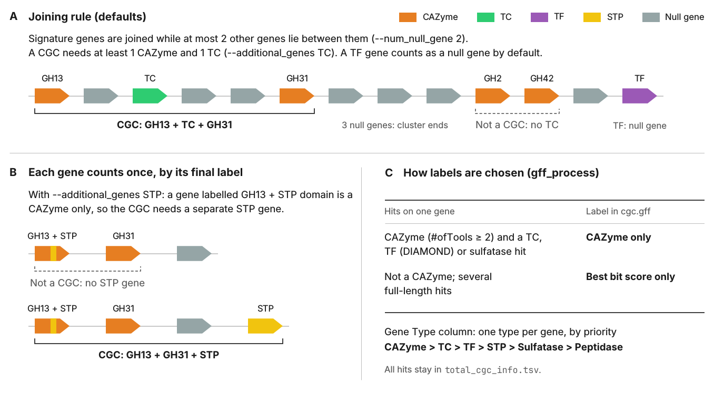

.. _cgc-finder:

CGC Identification (``cgc_finder``)
===================================

Step 3 of the pipeline. ``cgc_finder`` reads ``cgc.gff`` (written by ``gff_process``) and reports every group of
neighbouring CAZymes and signature genes that passes the CGC rules.

.. code-block:: shell

   run_dbcan cgc_finder --output_dir output_EscheriaColiK12MG1655_fna

Output: ``cgc_standard_out.tsv`` (one row per gene of each CGC) and ``cgc_standard_out_summary.tsv`` (one row per
CGC: gene counts per type and length). ``cgc.gff`` is not modified.

CGC rules
---------

.. _cgc-rules-figure:

   **A** default joining rule; **B** each gene counts once, by its final Gene Type: a CAZyme with an STP domain does
   not fill the STP role; **C** how :ref:`gff_process <cgc-information-generation>` chooses the labels of a gene in
   ``cgc.gff``, and the ``Gene Type`` priority. Gene colours as in the run_dbcan CGC plots.

#. **Signature genes**: CAZymes (``#ofTools`` >= 2) and genes whose Gene Type is one of the ``--additional_genes``
   types (default ``TC``). All other genes, including TF/STP genes that are not listed, count as null genes.
#. **Joining**: on each contig, consecutive signature genes are joined while at most ``--num_null_gene`` (2) null
   genes lie between them. ``--use_distance`` also requires them to be at most ``--base_pair_distance`` (15000 bp)
   apart; ``--no-use_null_genes`` drops the gene-count rule.
#. **Validation**: a candidate is a CGC when it has >= ``--min_cluster_genes`` (2) genes, >= ``--min_core_cazyme``
   (1) CAZymes and the additional types (``--additional_logic all``: every listed type; ``any``: at least
   ``--additional_min_categories``). With the defaults: at least one CAZyme **and** one transporter.
#. **Each gene counts once, by its final Gene Type**: the ``Gene Type`` column, one type per gene by priority
   CAZyme > TC > TF > STP > Sulfatase > Peptidase. Its other labels stay in ``Gene Annotation`` but fill no role:
   a ``CAZyme|GH13+STP|...`` gene is a CAZyme, never the STP, and ``TC|...+STP|...`` is a TC only.

Options
-------

.. list-table::
   :widths: 40 60
   :header-rows: 1

   * - Option
     - Description (default)
   * - ``--additional_genes``
     - Required signature types besides CAZyme; repeat for several: ``TC``, ``TF``, ``STP``, ``Sulfatase``,
       ``Peptidase`` (``TC``)
   * - ``--additional_logic`` / ``--additional_min_categories``
     - ``all`` = every listed type, ``any`` = at least N types (``all`` / 1)
   * - ``--num_null_gene``
     - Maximum null genes between two signature genes (2)
   * - ``--use_null_genes`` / ``--no-use_null_genes``
     - Use the null-gene rule (on)
   * - ``--use_distance`` / ``--base_pair_distance``
     - Also require a maximum distance in bp (off / 15000)
   * - ``--min_core_cazyme`` / ``--min_cluster_genes``
     - Minimum CAZymes (1) and genes (2) per CGC
   * - ``--extend_mode none|bp|gene``
     - Add flanking genes after detection, with ``--extend_bp`` or ``--extend_gene_count`` (``none``)

.. code-block:: shell

   # looser: any of TC, TF, STP; up to 5 null genes; and at most 15 kb apart
   run_dbcan cgc_finder --output_dir output_dir --num_null_gene 5 --use_distance --base_pair_distance 15000 \
     --additional_genes TC --additional_genes TF --additional_genes STP --additional_logic any

.. note::

   * **CAZyme pairs**: ``--additional_genes CAZyme`` (alone) reports clusters of >= 2 CAZymes; all other genes then
     count as null genes. Next to other types, ``CAZyme`` asks for one CAZyme more than ``--min_core_cazyme``.
   * **Extensions** (``--extend_mode``) are added after the CGCs are found and do not count for the rules. They stop
     before the core of a neighbouring CGC; a gene both extensions would reach goes to the CGC whose core is nearer
     (ties: upstream CGC), so no gene is in two CGCs.
   * **Custom types**: add your own label to the ``CGC_annotation`` attribute of ``cgc.gff`` (``<Type>|<name>``)
     and list it in ``--additional_genes``. tRNAs and other non-coding genes are null genes unless listed.
   * ``--feature_type`` is deprecated and ignored: the GFF feature type is chosen by ``gff_process`` from
     ``--gff_type``.

No CGC found? See the checklist in :doc:`../FAQ/troubleshooting`.

Annotating null genes with Pfam (optional)
------------------------------------------

``Pfam_null_cgc`` adds Pfam-A domains (pyHMMER) to the null genes of the CGCs. It needs ``Pfam-A.hmm`` in
``--db_dir``, which ``run_dbcan database`` does **not** download (see :doc:`prepare_the_database`).

.. code-block:: shell

   run_dbcan Pfam_null_cgc --output_dir output_dir --db_dir db --null_from_gff

* ``--null_from_gff`` searches only the proteins of all ``null`` genes of ``cgc.gff`` (``null_proteins.faa``);
  without it all of ``uniInput.faa`` is searched (slower). ``--e_value_threshold_pfam`` (1e-4) and
  ``--coverage_threshold_pfam`` (0.35 of the HMM) filter the hits.
* Outputs: ``Pfam_hmm_results.tsv``, ``cgc_standard_out.pfam_annotated.tsv`` and ``cgc.pfam_annotated.gff``.
* The old ``--run_pfam`` flag is accepted and ignored.

Next: :doc:`predict_CGC_substrate` (step 4) or :doc:`CGC_plots`.
