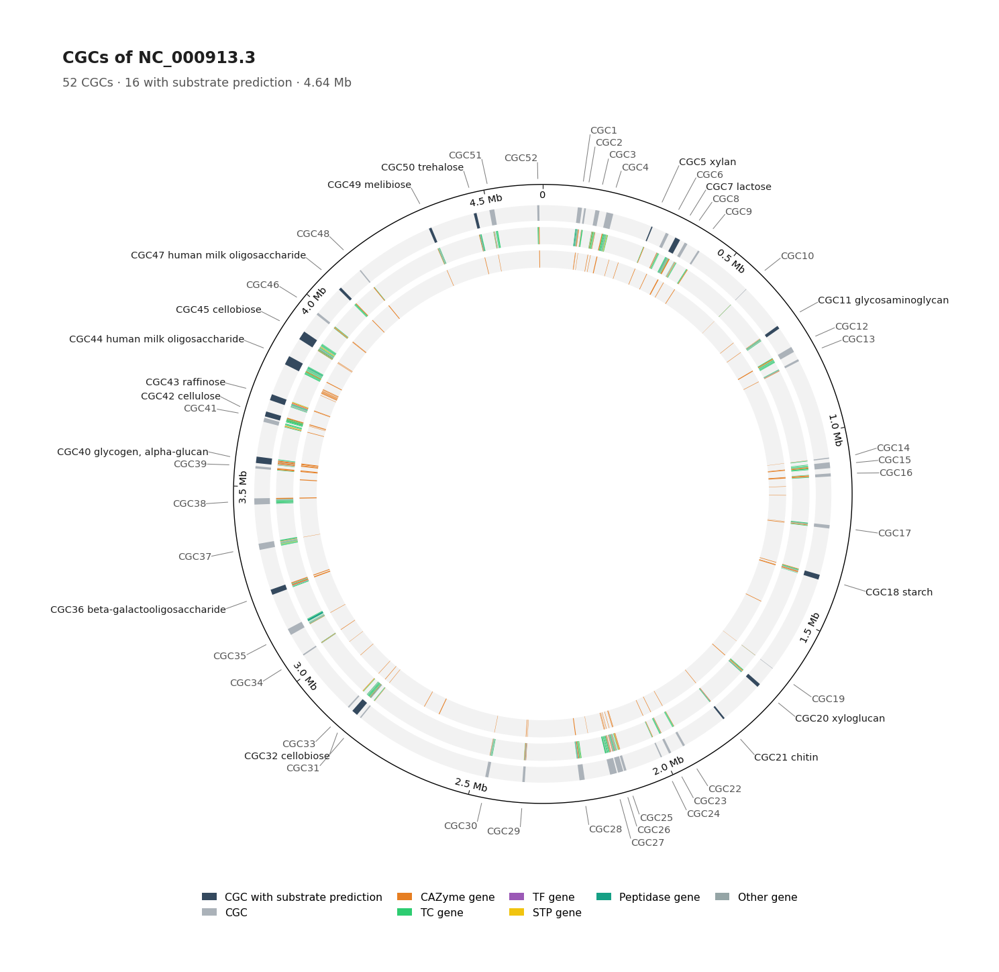
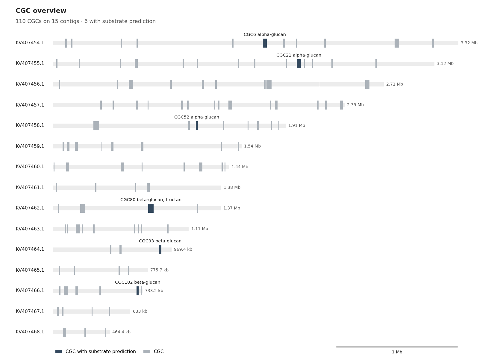
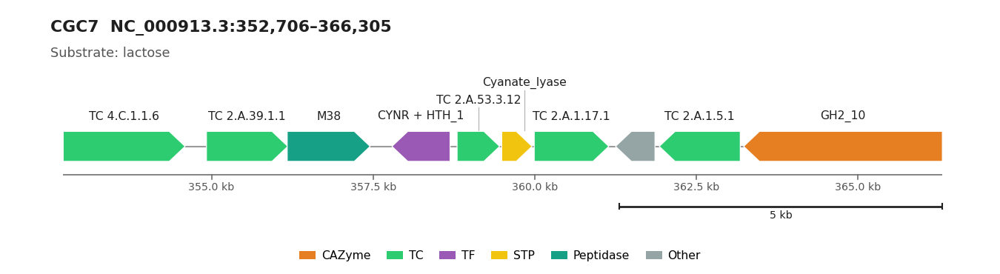
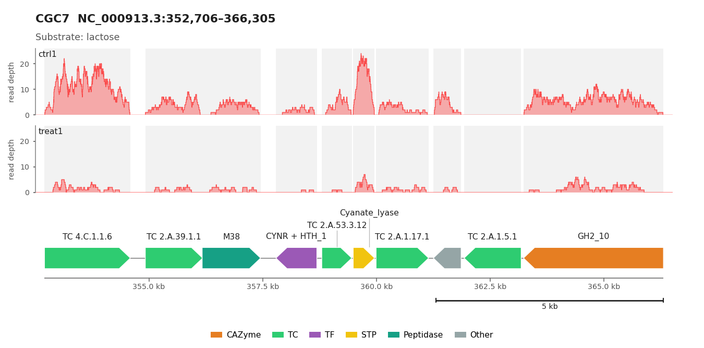
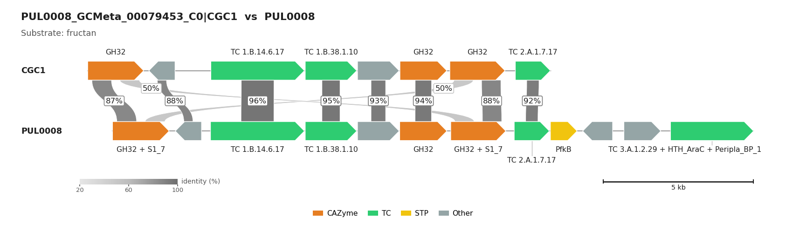

.. _cgc_visualization:

CGC Figures
===========

Four kinds of figures are drawn from a run_dbcan output directory (``cgc.gff``, ``cgc_standard_out.tsv`` and,
when present, ``substrate_prediction.tsv``, ``PUL_blast.out``, ``DEG.tsv``). This page explains how to make and
read each one; the :ref:`figure_gallery` shows every figure with the exact command that made it.

.. list-table::
   :widths: 26 36 38
   :header-rows: 1

   * - Figure
     - Command
     - Shows
   * - :ref:`Genome view <cgc-genome-view>`
     - ``run_dbcan cgc_circle_plot``
     - All CGCs on the genome or assembly
   * - :ref:`CGC map <cgc-map>`
     - ``dbcan_plot CGC_plot``
     - The genes of one CGC
   * - :ref:`CGC map + read depth <cgc-coverage>`
     - ``dbcan_plot CGC_coverage_plot``
     - The same map under one depth panel per sample
   * - :ref:`Synteny with dbCAN-PUL <cgc-synteny>`
     - ``substrate_prediction`` (all CGCs); ``dbcan_plot CGC_synteny_plot`` / ``CGC_synteny_coverage_plot``
     - One CGC above its best (or a chosen) dbCAN-PUL

Abundance charts (``dbcan_plot bar_plot`` / ``heatmap_plot``) are described in :ref:`abundance-charts`.

Colours
-------

All figures share one palette. A gene with several roles (``CAZyme|GH13_31+TC|8.A.9.1.1``) gets **one** colour,
by the ``Gene Type`` priority CAZyme > TC > TF > STP > Sulfatase > Peptidase; its other roles appear only in its
label (``GH13_31 + TC 8.A.9.1.1``).

.. list-table::
   :widths: 30 30 40
   :header-rows: 1

   * - Gene type
     - Colour
     - Note
   * - CAZyme
     - orange ``#E67E22``
     -
   * - TC (transporter)
     - green ``#2ECC71``
     -
   * - TF (transcription factor)
     - purple ``#9B59B6``
     - TF number + family name: the family is shown (``HTH_AraC``)
   * - STP (signal transduction)
     - yellow ``#F1C40F``
     -
   * - Peptidase
     - teal ``#16A085``
     - also ``PEPTIDASE`` in dbCAN-PUL files
   * - Sulfatase
     - dark blue ``#010E1B``
     - also ``SULFATLAS`` in dbCAN-PUL files
   * - Other (no signature, RNA)
     - grey ``#95A5A6``
     -
   * - CGC extent (genome views)
     - slate ``#34495E`` / cool grey ``#ABB2B9``
     - with / without a substrate prediction

Legends list only the types present.

.. _cgc-genome-view:

Genome view: ``cgc_circle_plot``
--------------------------------

.. code-block:: shell

   run_dbcan cgc_circle_plot --output_dir output_EscheriaColiK12MG1655_fna       # 1 contig  -> circos
   run_dbcan cgc_circle_plot --output_dir output_Xylona_heveae_TC161_faa         # 23 contigs -> overview
   run_dbcan cgc_circle_plot --output_dir output_Xylona_heveae_TC161_faa --layout circos

Run it after ``cgc_finder`` (after ``substrate_prediction`` for substrate labels). Figures go to
``<output_dir>/cgc_circos/``. ``--layout auto`` (default) draws a circos plot when ``cgc.gff`` has one contig,
otherwise the overview; ``circos`` or ``overview`` force one.

   Circos layout (``cgc_circos_plot.png``/``.pdf``), *E. coli* K-12: 52 CGCs, 16 with a substrate.

**Circos rings**, outside in: axis; CGC extents labelled ``CGCn substrate`` (with more than 60 CGCs only those with
a substrate are labelled); the genes of the CGCs in their colour; all CAZyme genes of the genome. If
``<output_dir>/DEG.tsv`` exists (protein ID and log2 fold change, tab-separated, no header), two inner rings show
up-/down-regulated genes (red/blue; ``NA`` values are skipped) and the log2FC profile. With ``--layout circos`` on
several contigs, each contig is a sector named inside the innermost ring (narrow sectors stay unnamed, long names are
shortened); the ticks are labelled on the largest sector only and the subtitle gives their interval.

   Overview layout (``cgc_overview.png``/``.pdf``), *Xylona heveae*: 110 CGCs on 15 of 23 scaffolds.

**Overview**: one bar per contig with a CGC (longest first, at most 60, one shared bp scale), its length at the end;
CGCs are blocks labelled ``CGCn substrate`` when predicted (CGC ids where they fit when no prediction exists).
Contig lengths come from ``##sequence-region`` lines of ``cgc.gff``, else from the last gene.

.. _cgc-map:

CGC map: ``dbcan_plot CGC_plot``
--------------------------------

.. code-block:: shell

   dbcan_plot CGC_plot -i output_EscheriaColiK12MG1655_fna --cgcid 'NC_000913.3|CGC7' -o figures --format pdf,png

   *E. coli* CGC7: the *lac* genes (``GH2_10`` = LacZ, ``TC 2.A.1.5.1`` = LacY) next to the *cyn* operon.

Genes are arrows to scale in the direction of their strand, labelled with their family (crowded labels are stacked
and joined by leader lines). The title gives the location and the predicted substrate. Only the CGC's genes are
drawn; ``--show-protein-ids`` adds protein IDs. Output: ``<contig>_<CGC>.cgc.<format>``.

.. _cgc-coverage:

CGC map with read depth: ``dbcan_plot CGC_coverage_plot``
---------------------------------------------------------

.. code-block:: shell

   samtools depth -a -r 'NC_000913.3:352706-366305' ctrl1.bam  > ctrl1.CGC7.depth.txt
   samtools depth -a -r 'NC_000913.3:352706-366305' treat1.bam > treat1.CGC7.depth.txt
   dbcan_plot CGC_coverage_plot -i output_EscheriaColiK12MG1655_fna --cgcid 'NC_000913.3|CGC7' \
       --reads-count ctrl1.CGC7.depth.txt --reads-count treat1.CGC7.depth.txt --samples ctrl1,treat1 -o figures

   CGC7 with simulated RNA-seq reads: expressed four times lower in ``treat1``. Grey bands mark the genes.

* ``--reads-count`` takes a ``samtools depth`` file (contig, position, depth); repeat it, one panel per file (first
  on top), all on one y axis. ``--samples`` names the panels (default: file names).
* A whole-assembly depth file works: only rows of the CGC window are used. Contig names must be those of
  ``cgc.gff``: a file without the CGC's contig (``NC_000913`` vs ``NC_000913.3``) is an error; a contig without rows
  in the window gives a warning and a zero panel.
* Output: ``<contig>_<CGC>.cgc-coverage.<format>``.

.. _cgc-synteny:

Synteny with dbCAN-PUL
----------------------

``substrate_prediction`` writes ``synteny_pdf/<contig>_<CGC>_<PUL>-syntenic.pdf`` for every CGC with a PUL hit.
``dbcan_plot`` draws the same figure for one CGC, against its best PUL or another one (``--pul``):

.. code-block:: shell

   dbcan_plot CGC_synteny_plot -i output_dir --cgcid 'NC_000913.3|CGC7' --db-dir db -o figures
   dbcan_plot CGC_synteny_plot -i output_dir --cgcid 'NC_000913.3|CGC7' --db-dir db --pul PUL0751 --no-synteny-revcomp
   dbcan_plot CGC_synteny_coverage_plot -i output_dir --cgcid 'NC_000913.3|CGC7' --db-dir db --reads-count ctrl1.CGC7.depth.txt

   The PUL0008 region against PUL0008: one-to-one pairs (87-96%) and two paralogous ``GH32`` genes that also hit
   each other's counterpart (light 50% ribbons, labels above the main row).

How to read it:

* The CGC is on top, the dbCAN-PUL (from ``<db_dir>/dbCAN-PUL/<PUL>.out/cgc.gff``) below, shifted so that homologous
  genes sit under each other; with ``--synteny-revcomp`` (default) it is reverse-complemented when most pairs lie on
  opposite strands.
* Ribbons join homologous genes; their grey level and tag give the % identity. Tags of one-to-one pairs form one row
  half-way; tags of multiple matches sit above it. A gene with several hits gives each ribbon its own slot.
* Only hits that pass the substrate-prediction cut-offs are drawn: ``--evalue-cutoff`` (0.01),
  ``--identity-cutoff`` (percent, 0), ``--coverage-cutoff`` (fraction, 0); ``substrate_prediction`` uses its own
  ``-evalue``/``-iden``/``-cov``.
* ``CGC_synteny_coverage_plot`` adds the depth panels of ``CGC_coverage_plot`` above the CGC
  (``<cgc>_<PUL>-syntenic-cov.<format>``).

.. _dbcan-plot-options:

``dbcan_plot`` options
----------------------

.. list-table::
   :widths: 34 66
   :header-rows: 1

   * - Option
     - Description (default)
   * - ``-i`` / ``--input``
     - run_dbcan output directory (CGC figures) or comma-separated abundance files (charts)
   * - ``-o`` / ``--output-dir``
     - Folder for the figures, created if needed (``.``)
   * - ``--cgcid``
     - ``contig|CGCn`` as in ``substrate_prediction.tsv`` (contigs may contain ``|``)
   * - ``--format`` / ``--dpi``
     - CGC figures: ``pdf``, ``png``, ``svg`` or a list (``pdf``); PNG resolution (200)
   * - ``--db-dir``
     - Database folder with ``dbCAN-PUL/`` (``db``)
   * - ``--pul``
     - dbCAN-PUL to compare with (best hit)
   * - ``--reads-count`` / ``--samples``
     - Depth file (repeatable) / comma-separated names, one per depth or abundance file
   * - ``--synteny-revcomp`` / ``--no-synteny-revcomp``
     - Reverse-complement an opposite-strand PUL (on)
   * - ``--evalue-cutoff``, ``--identity-cutoff``, ``--coverage-cutoff``
     - Synteny link filters (0.01, 0, 0)
   * - ``--show-protein-ids``
     - Protein IDs under the genes (``CGC_plot``, ``CGC_coverage_plot``)
   * - ``--top``, ``--col``, ``--value``
     - Charts: number of rows (20), or the rows whose column ``--col`` has one of the ``--value`` values
   * - ``--pdf``
     - Chart file name (``bar_plot.pdf`` / ``heatmap.pdf``, ``heatmap_cluster.pdf``), written into ``-o``
   * - ``--vertical-bar``
     - ``bar_plot``: vertical bars
   * - ``--plot-style``
     - Chart style: ``ggplot`` (default), ``seaborn-v0_8*``, ``default``, ``classic``, ``bmh``,
       ``fivethirtyeight`` (``seaborn``, ``seaborn-poster`` are mapped to ``seaborn-v0_8``)
   * - ``--show-abund``, ``--cluster-map``, ``--palette``
     - ``heatmap_plot``: values in cells, clustered rows, colormap
   * - ``--show-fig``
     - ``heatmap_plot``: also open a window; without a display the PDF is written and the exit status is 1

``dbcan_plot`` exits with status 1 and a message when a figure cannot be drawn (unknown ``--cgcid``, missing or
wrong depth file, no dbCAN-PUL hit, empty abundance file, ...). PDF and SVG keep the text editable (Inkscape,
Illustrator).
