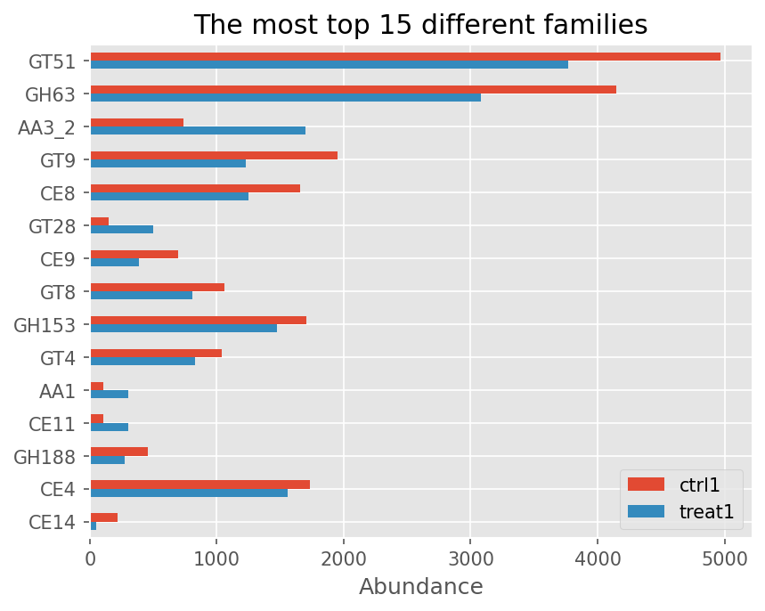
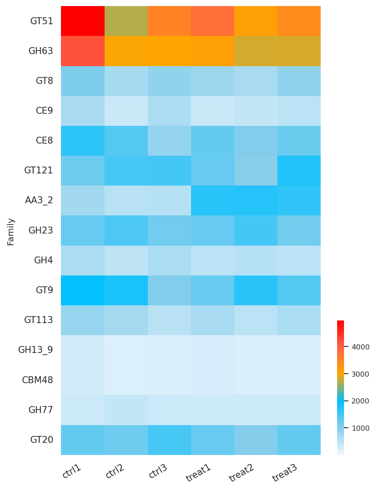

.. _dbcan-utils-abundance:

Read abundance with dbcan_utils
===============================

``dbcan_utils`` turns read alignments (metagenomic or metatranscriptomic reads mapped to the
contigs that run_dbcan annotated) into abundances of CAZyme families, subfamilies, ECs,
substrates and CGCs. It runs in two steps:

1. ``cal_coverage`` counts the reads of every gene from a sorted, indexed BAM file and a GFF file.
2. ``fam_abund``, ``fam_substrate_abund``, ``CGC_abund`` and ``CGC_substrate_abund`` combine the
   counts with the run_dbcan output directory.

.. code-block:: shell

   samtools sort -o sample.bam sample.sam && samtools index sample.bam
   dbcan_utils cal_coverage -g sample.dbCAN/cgc.gff -i sample.bam -o sample.depth.txt -t 6
   dbcan_utils fam_abund           -bt sample.depth.txt -i sample.dbCAN -a TPM -o sample_abund
   dbcan_utils fam_substrate_abund -bt sample.depth.txt -i sample.dbCAN -a TPM -o sample_abund
   dbcan_utils CGC_abund           -bt sample.depth.txt -i sample.dbCAN -a TPM -o sample_abund
   dbcan_utils CGC_substrate_abund -bt sample.depth.txt -i sample.dbCAN -a TPM -o sample_abund

Every command exits with a non-zero status when it cannot produce its output (missing input,
BAM without index, no GFF contig in the BAM, or no gene ID shared by the count table and the
run_dbcan tables).

Counting reads per gene: ``cal_coverage``
-----------------------------------------

Gene IDs
^^^^^^^^

The count table must use the protein IDs of the run_dbcan tables. The simplest choice is the
``cgc.gff`` that run_dbcan writes into its output directory: it uses exactly those IDs.
Other GFF files also work. With the default ``--id-attr auto``:

* if the GFF has ``protein_id`` (NCBI GFF, run_dbcan ``cgc.gff``) or ``proteinId`` (JGI)
  attributes, only the rows with that attribute are used and are named by it;
* otherwise every row is named by ``ID``, then ``Name``, then ``locus_tag``
  (Prodigal/pyrodigal, Prokka, Bakta);
* when the selected rows include ``CDS`` rows, only ``CDS`` rows are counted, so a gene and its
  CDS are not counted twice; all rows with the same ID (the exons of one CDS) form one gene and
  the gene length is the length of their union;
* features without a protein (``protein_id=NA`` / ``unknown`` in ``cgc.gff``: tRNA, rRNA, ...)
  are skipped.

For annotations whose proteins are named after the transcript (e.g. funannotate or BRAKER GFF3,
where proteins are called after the mRNA ``ID``), count the CDS rows under their parent:
``--id-attr Parent --feature-type CDS``. Prodigal GFFs (``ID=1_1``) need ``dbcan_utils gff_fix``
first so that the IDs match the protein FASTA.

Which GFF to use:

.. list-table::
   :header-rows: 1
   :widths: 30 70

   * - run_dbcan input
     - GFF for ``cal_coverage``
   * - prokaryote / metagenome (``--mode prok`` / ``meta``, ``NCBI_prok``, ``prodigal``)
     - ``cgc.gff`` of the run_dbcan output directory (one row per gene = its CDS).
   * - eukaryote with an NCBI, funannotate, BRAKER, GFF3 or GTF annotation
     - the **original annotation GFF** (NCBI: default ``--id-attr auto``, which uses the
       ``protein_id`` of the CDS rows; funannotate/BRAKER: ``--id-attr Parent --feature-type CDS``).
       The CDS exons of a protein are merged, so introns and UTRs are not counted. Do **not** use
       ``cgc.gff`` here: its eukaryotic ``gene`` rows span the whole gene, introns and UTRs
       included (on *Xylona heveae* the median ``cgc.gff`` gene is 1.37 times longer than its
       CDS), which lowers FPKM/TPM and counts intronic reads.
   * - eukaryote with a JGI annotation (``--gff_type JGI``)
     - ``cgc.gff``: the raw ``proteinId`` values of the JGI GFF (``242238``) are not the protein
       IDs that run_dbcan uses (``jgi-Xylhe1-242238-...``), so the original GFF matches no gene.
       The gene lengths then include introns (see above).

Which alignments are counted
^^^^^^^^^^^^^^^^^^^^^^^^^^^^

An alignment counts for a gene when all of the following hold:

* it is a primary alignment: secondary (0x100) and supplementary (0x800) alignments, reads that
  fail QC (0x200) and duplicates (0x400, unless ``--include-duplicates``) are ignored;
* its MAPQ is at least ``--mapping-quality`` (default 30);
* at least ``--overlap-base-ratio`` (default 0.2) of the read length lies inside the gene
  (with ``--hifi``: of the shorter of read and gene);
* its identity is at least ``--identity`` (default 0.98). Identity is ``1 - edits / alignment
  columns`` (aligned columns = matches, mismatches, inserted and deleted bases) with the edits
  taken from the ``NM`` tag (mismatches, inserted and deleted bases), else from ``MD`` plus
  insertions, else from ``=``/``X`` CIGAR operations. Inserted bases count as edits, so this is
  slightly stricter than run_dbcan 5.2.9, which used the ``MD`` tag only and ignored insertions. Alignments without any of these are counted (the filter cannot be
  applied) and a warning reports how many; add tags with ``samtools calmd`` to filter them.
  ``--identity 0`` turns the filter off.

``--count-mode fragments`` (default) counts each read pair once per gene, when either mate
passes the filters; ``--count-mode reads`` counts every read (the behaviour of run_dbcan 5.2.9
and earlier, which doubled paired-end counts). Each gene is counted on its own: a fragment whose
two mates fall in two different genes (or whose read overlaps two genes) counts once for **each**
of them, so the sum of the gene counts can exceed the number of fragments. Single-end reads are counted the same way in both
modes. RPM, FPKM/RPKM and TPM are ratios of counts, so the mode does not change TPM and RPM; it only
changes the raw counts (use ``fragments`` for count-based tools such as DESeq2 or edgeR).

Strand: by default reads on both strands are counted (``--strandedness none``), so a read in
the overlap of two genes on opposite strands counts for both. For stranded RNA-seq use
``--strandedness reverse`` (dUTP / TruSeq stranded: read 1 antisense to the transcript) or
``--strandedness forward`` (read 1 sense).

.. warning::

   With most aligners, reads of genes that occur in several identical copies (e.g. transposase,
   rRNA operon genes, recent paralogs) get MAPQ 0 or 1, so such genes get **0 reads** at the
   default ``--mapping-quality 30``. Lower the threshold (e.g. ``--mapping-quality 0``) if they
   matter; their reads are then counted at the primary alignment only.

The output is a tab-separated table without header: gene ID, gene length (bp), count.

The log reports the alignments that were not counted, each alignment once whatever the number of
genes or exons it overlaps (``secondary_or_supplementary``, ``qc_fail``, ``duplicate``,
``low_mapq``, ``low_identity``), and separately the alignment/gene pairs rejected for one gene
(``wrong_strand``, ``low_overlap``); such an alignment can still count for another gene.

Abundance: ``*_abund``
----------------------

``-i`` is the run_dbcan output directory (it must exist), ``-bt`` the ``cal_coverage`` table and ``-o`` the output
directory (created if needed; default: current directory). ``-a`` chooses the normalisation, where
*count* is the ``cal_coverage`` count of a gene and *N* the sum of the counts of all genes in the
table:

* **RPM** (default) = count / (N / 10^6)
* **FPKM** (= **RPKM**) = count / (N / 10^6) / (gene length / 1000)
* **TPM** = (count / gene length) / sum over all genes (count / gene length) x 10^6

.. list-table::
   :header-rows: 1
   :widths: 25 20 55

   * - Function
     - Output files
     - Content
   * - ``fam_abund``
     - ``fam_abund.out``, ``subfam_abund.out``, ``EC_abund.out``
     - Sum of abundance of the proteins of each CAZy family (dbCAN HMM + dbCAN-sub), eCAMI
       subfamily and EC number (every EC of the ``EC#`` column of ``overview.tsv``, all domains),
       and the number of proteins.
   * - ``fam_substrate_abund``
     - ``fam_substrate_abund.out``
     - Sum of abundance of the proteins whose dbCAN-sub hits (all hits of a protein) name the
       substrate, and their IDs.
   * - ``CGC_abund``
     - ``CGC_abund.out``
     - Mean abundance of the protein-coding genes of each CGC, with their IDs, abundances and
       families in the same order (``Fams``: the CAZy family of CAZymes, ``<type>|<ID>`` such as
       ``TC|3.A.1.1.27`` or ``STP|HTH_1+LysR_substrate`` for the other signature genes, the role
       chosen by the Gene Type priority for multi-role genes; ``null`` for genes without a
       signature). Non-coding members (tRNA, ...) have no protein and are left out.
   * - ``CGC_substrate_abund``
     - ``CGC_substrate_PUL_homology.out``, ``CGC_substrate_majority_voting.out``
     - Sum of the CGC abundances per substrate predicted by dbCAN-PUL homology and by dbCAN-sub
       majority voting. A CGC whose prediction names several substrates (``arabinan,galactan``)
       counts for each of them, in both files (``,`` inside a chemical name such as
       ``alpha-1,4-glucan`` is not a separator).

Options that no longer have an effect (``-1/--r1``, ``-2/--r2``, ``--db-dir``) are still accepted
and print a warning.

Charts: ``dbcan_plot bar_plot`` and ``heatmap_plot``
----------------------------------------------------

``dbcan_plot`` draws the ``*_abund`` tables of several samples (one file per sample, comma-separated, named with
``--samples``). Both charts keep ``--top`` rows (default 20): with two or more files, the rows with the largest
absolute difference between the **first two** files; ``--col``/``--value`` choose rows by name instead. The output is
a PDF (``--pdf``). The options are listed in :ref:`cgc_visualization`.

.. code-block:: shell

   dbcan_plot bar_plot -i ctrl1_abund/fam_abund.out,treat1_abund/fam_abund.out --samples ctrl1,treat1 \
       --top 15 --pdf fam_bar.pdf -o figures
   dbcan_plot heatmap_plot -i ctrl1_abund/fam_abund.out,ctrl2_abund/fam_abund.out,treat1_abund/fam_abund.out \
       --samples ctrl1,ctrl2,treat1 --top 15 --pdf fam_heatmap.pdf -o figures

   ``bar_plot`` of ``fam_abund.out`` (TPM) of two samples of simulated *E. coli* RNA-seq reads.

   ``heatmap_plot`` of ``fam_abund.out`` (TPM) of six samples. The :ref:`figure_gallery` gives the full commands.
