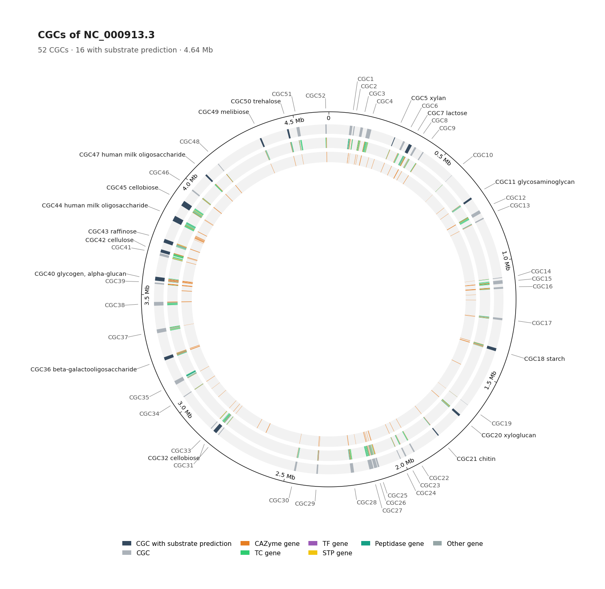
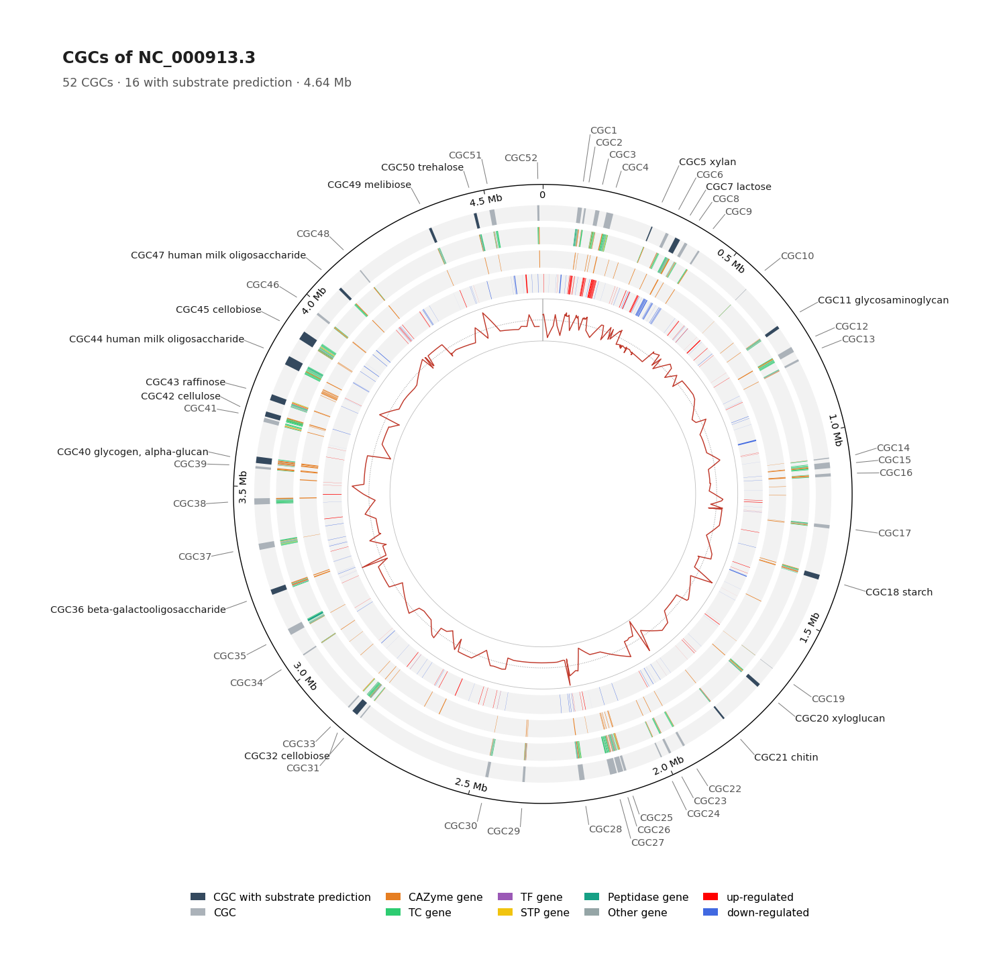
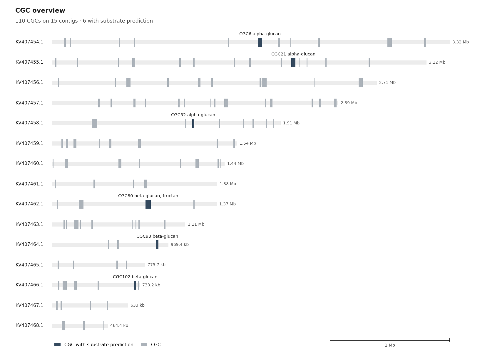
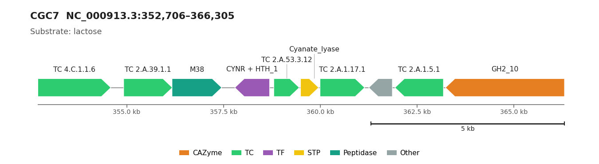
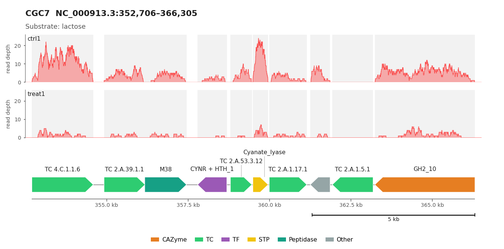
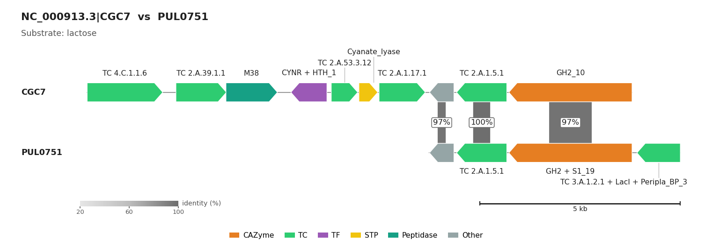
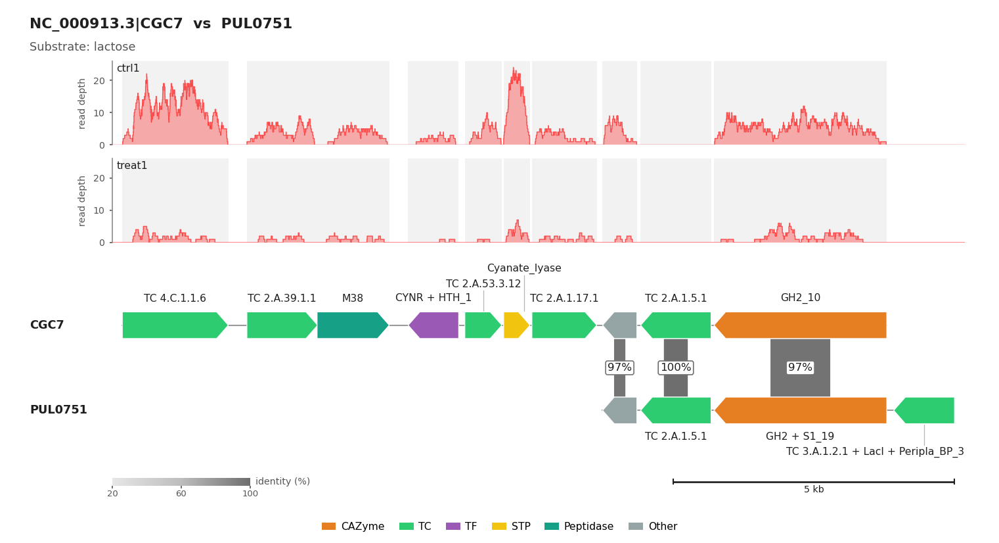
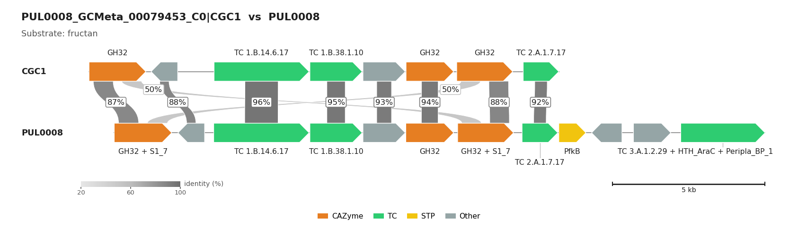
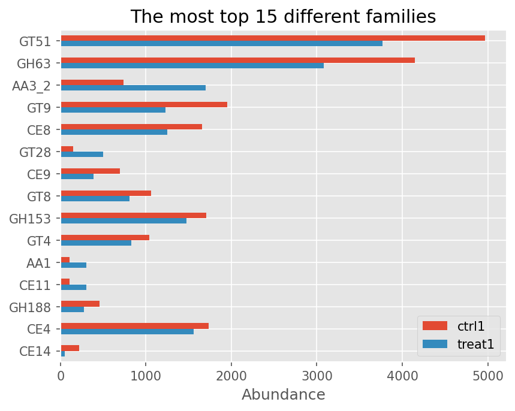
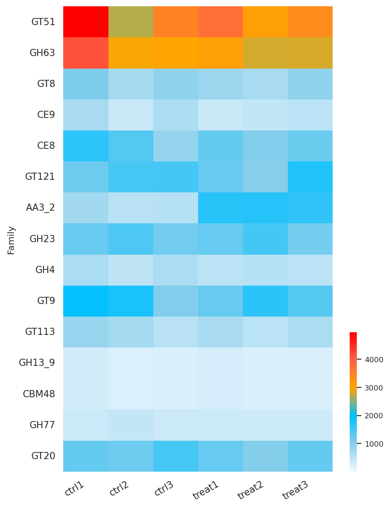

.. _figure_gallery:

Figure Gallery
==============

One example of every figure that run_dbcan, ``dbcan_plot`` and ``dbcan_utils`` can draw, with the command that
made it. The options of each command are described in :ref:`cgc_visualization` and
:ref:`dbcan-utils-abundance`.

Example data
------------

All figures come from real runs of the current code:

* *Escherichia coli* K-12 MG1655 (``NC_000913.3``, one complete chromosome; NCBI GFF, ``--gff_type NCBI_prok``),
  output directory ``output_EscheriaColiK12MG1655_fna``: 52 CGCs, 16 with a substrate prediction.
* *Xylona heveae* TC161 (fungus, 23 scaffolds; proteome with its NCBI GFF, ``--gff_type NCBI_euk --fungi``),
  output directory ``output_Xylona_heveae_TC161_faa``: 110 CGCs on 15 scaffolds, 6 with a substrate prediction.
* The genomic region of dbCAN-PUL ``PUL0008`` (fructan) run as a genome (``--gff_type prodigal``), output directory
  ``output_PUL0008``: its CGC is found again and matched to ``PUL0008``.
* Simulated paired-end RNA-seq reads of *E. coli* (three control samples ``ctrl1``-``ctrl3`` and three treatment
  samples ``treat1``-``treat3``), mapped to ``NC_000913.3`` and sorted/indexed with samtools. In the simulation the
  genes of some CGCs, among them CGC7 (the *lac* region), are expressed four times lower in the treatment samples.

The command lines write PDF (and PNG where noted). The images on this page are the PNG output, drawn at 150 dpi to
keep the page light; the commands write PNG at 200 dpi by default (``--dpi`` of ``dbcan_plot``).

Genome view: circos layout (one complete genome)
------------------------------------------------

The chromosome of *E. coli* with its 52 CGCs. Outer ring: CGC extents, slate when a substrate was predicted (the
label gives it, e.g. ``CGC7 lactose``), cool grey otherwise; middle ring: the genes of the CGCs in their gene-type
colour; inner ring: all CAZyme genes of the genome. ``--layout auto`` chooses this layout because ``cgc.gff`` has
one contig.

.. code-block:: shell

   run_dbcan cgc_circle_plot --output_dir output_EscheriaColiK12MG1655_fna
   # -> output_EscheriaColiK12MG1655_fna/cgc_circos/cgc_circos_plot.png and .pdf

Genome view: circos layout with differential expression
-------------------------------------------------------

The same plot when the output directory contains ``DEG.tsv`` (protein ID and log2 fold change, tab-separated, no
header). Two inner rings are added: up- (red) and down-regulated (blue) genes, and the log2 fold change profile. Here
``DEG.tsv`` lists the 224 genes with \|log2FC\| >= 1.5 (treatment vs control, mean TPM of the three samples of each
condition, genes with TPM >= 20 in one condition); in practice it is the output of DESeq2, edgeR or similar,
filtered to the significant genes.

.. code-block:: shell

   cp DEG.tsv output_EscheriaColiK12MG1655_fna/
   run_dbcan cgc_circle_plot --output_dir output_EscheriaColiK12MG1655_fna

Genome view: overview layout (many contigs)
-------------------------------------------

One bar per scaffold that carries a CGC (longest first, one shared bp scale), CGCs as blocks, labelled with their
substrate when one was predicted. ``--layout auto`` chooses this layout because the assembly has several contigs;
``--layout circos`` draws them as sectors of a circos plot instead.

.. code-block:: shell

   run_dbcan cgc_circle_plot --output_dir output_Xylona_heveae_TC161_faa
   # -> output_Xylona_heveae_TC161_faa/cgc_circos/cgc_overview.png and .pdf

CGC map: ``CGC_plot``
---------------------

The genes of one CGC drawn to scale, as arrows in the direction of their strand, coloured by gene type and labelled
with their family (CAZy family, TC number, TF/STP domain, peptidase family). CGC7 of *E. coli* holds the *lac*
genes (``GH2_10`` = LacZ, ``TC 2.A.1.5.1`` = LacY) next to the *cyn* operon; its substrate (lactose) comes from
``substrate_prediction.tsv``.

.. code-block:: shell

   dbcan_plot CGC_plot -i output_EscheriaColiK12MG1655_fna --cgcid 'NC_000913.3|CGC7' -o figures --format pdf,png
   # -> figures/NC_000913.3_CGC7.cgc.pdf and .png

CGC map with read depth: ``CGC_coverage_plot``
----------------------------------------------

One read-depth panel per sample above the gene map; all panels share the y axis, so the lower expression of CGC7 in
``treat1`` is visible at a glance. The grey bands mark the genes. The depth files are ``samtools depth -a`` output
(contig, position, depth) of the CGC window.

.. code-block:: shell

   samtools depth -a -r 'NC_000913.3:352706-366305' ctrl1.bam  > ctrl1.CGC7.depth.txt
   samtools depth -a -r 'NC_000913.3:352706-366305' treat1.bam > treat1.CGC7.depth.txt
   dbcan_plot CGC_coverage_plot -i output_EscheriaColiK12MG1655_fna --cgcid 'NC_000913.3|CGC7' \
       --reads-count ctrl1.CGC7.depth.txt --reads-count treat1.CGC7.depth.txt --samples ctrl1,treat1 \
       -o figures --format pdf,png
   # -> figures/NC_000913.3_CGC7.cgc-coverage.pdf and .png

Synteny with dbCAN-PUL: ``CGC_synteny_plot``
--------------------------------------------

The CGC above its best dbCAN-PUL hit (``PUL0751``, lactose). Homologous genes are joined by ribbons whose grey level
and label give the protein identity; the PUL is shifted so that homologous genes sit under each other. Only DIAMOND
hits that pass the cut-offs of substrate prediction are drawn. ``--pul`` compares the CGC with another PUL.

.. code-block:: shell

   dbcan_plot CGC_synteny_plot -i output_EscheriaColiK12MG1655_fna --cgcid 'NC_000913.3|CGC7' --db-dir db \
       -o figures --format pdf,png
   # -> figures/NC_000913.3_CGC7_PUL0751-syntenic.pdf and .png

Synteny with read depth: ``CGC_synteny_coverage_plot``
------------------------------------------------------

The synteny figure with the read-depth panels of ``CGC_coverage_plot`` above the CGC (same depth files).

.. code-block:: shell

   dbcan_plot CGC_synteny_coverage_plot -i output_EscheriaColiK12MG1655_fna --cgcid 'NC_000913.3|CGC7' --db-dir db \
       --reads-count ctrl1.CGC7.depth.txt --reads-count treat1.CGC7.depth.txt --samples ctrl1,treat1 \
       -o figures --format pdf,png
   # -> figures/NC_000913.3_CGC7_PUL0751-syntenic-cov.pdf and .png

Synteny PDFs of ``substrate_prediction``
----------------------------------------

``substrate_prediction`` (and ``easy_substrate``) writes this figure for every CGC with a dbCAN-PUL hit, as
``synteny_pdf/<contig>_<CGC>_<PUL>-syntenic.pdf``; the image shows one of them as PNG (the same figure as
``dbcan_plot CGC_synteny_plot`` with ``--format png``). Here the PUL0008 region finds itself: one-to-one pairs at
87-96 % identity, and the two paralogous ``GH32`` genes also hit each other's counterpart (light 50 % ribbons, labels
above the row of one-to-one labels).

.. code-block:: shell

   run_dbcan substrate_prediction --output_dir output_PUL0008 --db_dir db
   # -> output_PUL0008/synteny_pdf/PUL0008_GCMeta_00079453_C0_CGC1_PUL0008-syntenic.pdf

Abundance bar chart: ``bar_plot``
---------------------------------

The families whose abundance differs most between two samples (absolute difference of the first two files, largest
on top), from ``fam_abund.out`` of ``dbcan_utils fam_abund`` (TPM). ``subfam_abund.out``, ``EC_abund.out`` and the
other ``*_abund`` tables work the same way.

.. code-block:: shell

   for s in ctrl1 treat1; do
     dbcan_utils cal_coverage -g output_EscheriaColiK12MG1655_fna/cgc.gff -i $s.bam -o $s.depth.txt -t 2
     dbcan_utils fam_abund -bt $s.depth.txt -i output_EscheriaColiK12MG1655_fna -a TPM -o ${s}_abund
   done
   dbcan_plot bar_plot -i ctrl1_abund/fam_abund.out,treat1_abund/fam_abund.out --samples ctrl1,treat1 \
       --top 15 --pdf fam_bar.pdf -o figures
   # -> figures/fam_bar.pdf

Abundance heatmap: ``heatmap_plot``
-----------------------------------

Abundance of ``--top`` families in several samples (TPM, white below 0.1). As in ``bar_plot``, the rows are the
families with the largest absolute difference between the **first two** files (here ``ctrl1`` and ``ctrl2``), largest
first; ``--col``/``--value`` select rows by name instead. ``--show-abund`` prints the values in the cells and
``--cluster-map`` clusters the rows. The six ``fam_abund.out`` files were made as above.

.. code-block:: shell

   dbcan_plot heatmap_plot \
       -i ctrl1_abund/fam_abund.out,ctrl2_abund/fam_abund.out,ctrl3_abund/fam_abund.out,treat1_abund/fam_abund.out,treat2_abund/fam_abund.out,treat3_abund/fam_abund.out \
       --samples ctrl1,ctrl2,ctrl3,treat1,treat2,treat3 --top 15 --pdf fam_heatmap.pdf -o figures
   # -> figures/fam_heatmap.pdf

``bar_plot`` and ``heatmap_plot`` write PDF only; the images above are the same figures rendered as PNG.
