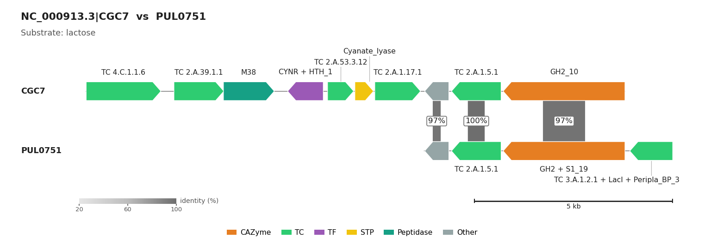

.. _substrate-prediction:

CGC Substrate Prediction
========================

Step 4 of the pipeline. Each CGC gets a substrate from two independent methods
(`dbCAN3 paper <https://academic.oup.com/nar/article/51/W1/W115/7147496>`_):

* **dbCAN-PUL homology**: the CGC proteins are searched (DIAMOND) against experimentally characterized
  polysaccharide utilization loci; the best matching PUL gives its substrate.
* **dbCAN-sub majority voting**: the substrates of the dbCAN-sub subfamilies of the CGC's CAZymes are scored.

.. code-block:: shell

   run_dbcan substrate_prediction --output_dir output_EscheriaColiK12MG1655_fna --db_dir db

It only reads files of earlier steps and re-runs nothing:

.. list-table::
   :widths: 50 50
   :header-rows: 1

   * - Needs
     - Writes
   * - ``cgc_standard_out.tsv``, ``uniInput.faa`` (required)
     - **substrate_prediction.tsv**
   * - ``dbCANsub_hmm_results.tsv`` (without it: dbCAN-PUL method only)
     - ``synteny_pdf/`` (one PDF per CGC with a PUL hit)
   * - ``<db_dir>/PUL.dmnd``, ``dbCAN-PUL.xlsx`` (required), ``dbCAN-PUL/`` (synteny plots)
     - ``CGC.faa``, ``PUL_blast.out`` (DIAMOND queries and hits)

A missing required file is logged as an error and ``substrate_prediction.tsv`` is written with its header only.

.. note::

   ``substrate_prediction`` takes no ``--mode`` or ``--input_raw_data`` (releases up to 5.2.9 required them,
   GitHub issue #81; old command lines still run, the values are ignored). ``easy_substrate`` runs steps 1-4 and
   needs them for step 1.

``substrate_prediction.tsv``
----------------------------

One row per CGC with a prediction, sorted by contig and CGC number (``CGC2`` before ``CGC10``).

.. list-table::
   :widths: 30 70
   :header-rows: 1

   * - Column
     - Content
   * - ``#cgcid``
     - ``<contig>|<CGC#>`` (contig IDs may themselves contain ``|``)
   * - ``PULID``, ``dbCAN-PUL substrate``, ``bitscore``
     - Best dbCAN-PUL, its substrate and the sum of the bit scores of the matched genes; ``-`` substrate for a PUL missing from
       ``dbCAN-PUL.xlsx`` (with a warning)
   * - ``signature pairs``
     - Gene-type pairs of the CGC-PUL hits, e.g. ``CAZyme-CAZyme;TC-TC``
   * - ``dbCAN-sub substrate``, ``dbCAN-sub substrate score``
     - Highest-scoring dbCAN-sub substrate(s) (ties joined with ``,``) and the score

Here a ``,`` between two substrates is a separator, but a ``,`` between digits belongs to a name
(``alpha-1,4-glucan``). ``dbcan_utils CGC_substrate_abund`` splits them the same way.

The per-protein ``Substrate`` column of ``overview.tsv`` is a different result: it comes from step 1, without CGCs
(see :ref:`overview-columns`).

Synteny figures
---------------

   ``synteny_pdf/NC_000913.3_CGC7_PUL0751-syntenic.pdf`` (*E. coli*, shown as PNG): CGC7 shares three genes
   (97-100% identity) with PUL0751, the source of its lactose prediction. How to read it:
   :ref:`cgc-synteny`.

Only the DIAMOND hits that pass ``-evalue``/``-iden``/``-cov`` are drawn. The figures are made after
``substrate_prediction.tsv`` is complete; if one fails (usually ``<db_dir>/dbCAN-PUL/<PUL>.out/cgc.gff`` is
missing), the command exits with a **non-zero status**. Restore ``dbCAN-PUL/`` (``run_dbcan database``) and run
it again.

Options
-------

.. list-table::
   :widths: 36 64
   :header-rows: 1

   * - Option
     - Description (default)
   * - ``-evalue`` / ``--evalue_cutoff``
     - Maximum E-value of a DIAMOND hit against dbCAN-PUL (0.01)
   * - ``-iden`` / ``--identity_cutoff``
     - Minimum percent identity, **0-100** (0 = off). For 30% use ``-iden 30``, not ``0.3``
   * - ``-cov`` / ``--coverage_cutoff``
     - Minimum query coverage, **fraction 0-1** of the CGC protein (0)
   * - ``-bsc`` / ``--bitscore_cutoff``
     - Minimum CGC-PUL bit score, averaged over the matched PUL proteins (50)
   * - ``-upghn`` / ``-uqcgn``
     - Minimum distinct PUL genes hit / distinct CGC genes with a hit (2 / 2)
   * - ``-cpn`` / ``-tpn``
     - Minimum CAZyme-CAZyme pairs / total pairs of any type (1 / 2)
   * - ``-ept`` / ``-eptn``
     - Extra pair types required, e.g. ``-ept TC-TC,STP-STP -eptn 1,1`` (one count per type, else an error)
   * - ``-hmmevalue`` / ``-hmmcov``
     - dbCAN-sub hits used for voting: maximum i-Evalue (0.01), minimum HMM coverage 0-1 (0)
   * - ``-ndsc`` / ``-npsc`` / ``-subs``
     - Minimum substrate domains (2), proteins (2) and score (2.0) for a dbCAN-sub call
   * - ``--synteny_revcomp`` / ``--no-synteny_revcomp``
     - Draw the PUL reverse-complemented when it lies on the opposite strand (on)
   * - ``-odbcan_sub true``
     - Also write ``substrate_prediction_dbcan_sub.tsv`` (``false``)
   * - ``-odbcanpul true``
     - Also write ``substrate_prediction_dbcan_pul.tsv`` (``false``)

DIAMOND uses all CPUs here; ``easy_substrate`` uses ``--threads``. The run_dbcan 3/4 options ``--pul``,
``-o/--out``, ``-w/--workdir``, ``-rerun`` and ``-env`` are hidden and ignored with a warning.

.. note::

   **Optional tables.**

   * ``substrate_prediction_dbcan_sub.tsv``: every dbCAN-sub hit of a CGC protein that passes
     ``-hmmevalue``/``-hmmcov`` (subfamily, EC, substrate, i-Evalue, coverage), then ``CGC substrate scores``
     (``substrate:score``, highest first; ``-`` when ``-ndsc``/``-npsc`` fail), ``CGC dbCAN-sub substrate`` and
     its score (``-`` below ``-subs``).
   * ``substrate_prediction_dbcan_pul.tsv``: the DIAMOND hits between each CGC and its best PUL.
   * ``CGC.faa`` headers are ``<contig>|<CGC#>|<protein>|<Gene Type>|<family>``; the family is that of the Gene
     Type role (``CAZyme|GH32_e132+Sulfatase|S1_7`` gives ``GH32_e132``), several joined with ``+``, TC IDs cut to
     three levels (``1.A.1``).

Next: :doc:`CGC_plots`.
